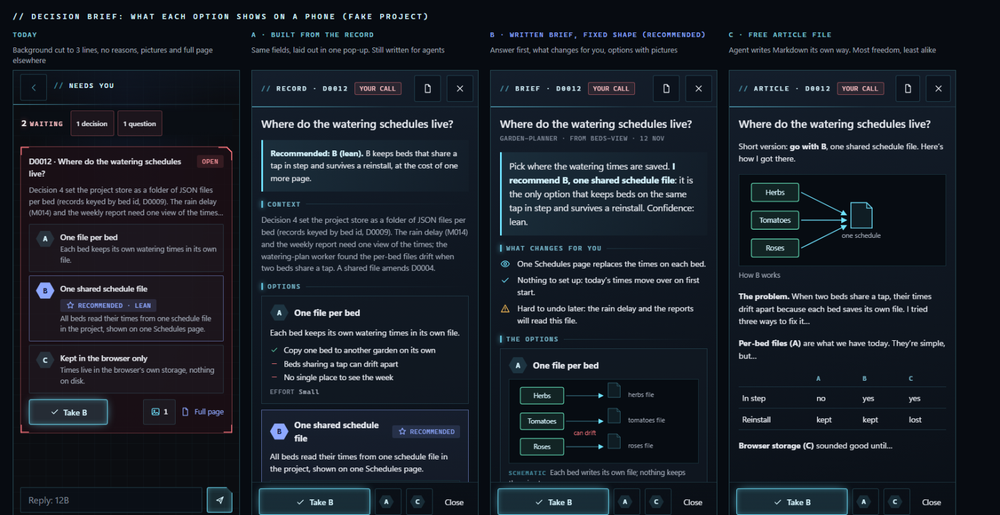
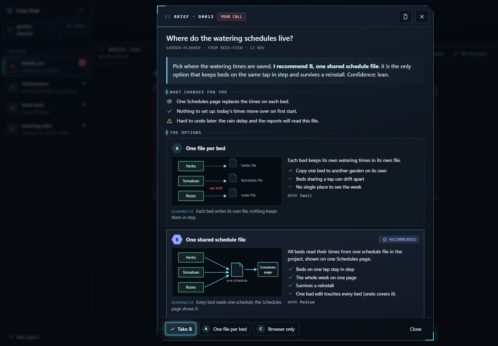
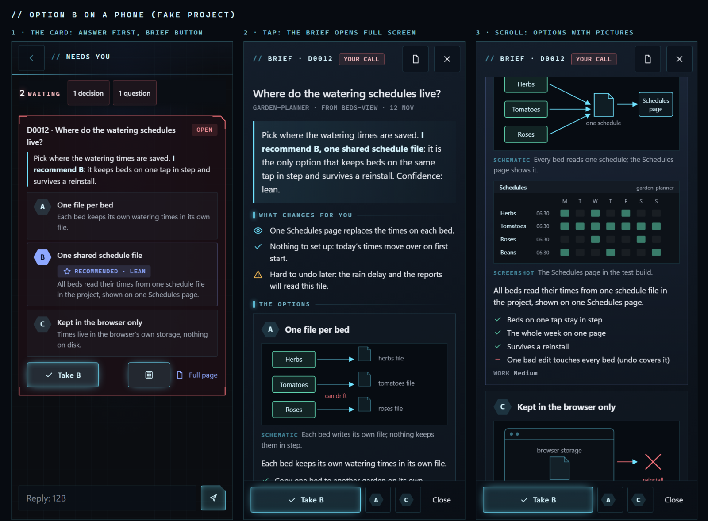

# 0050 How should a decision card open a readable brief for you?

- Status: decided
- Date: 2026-11-12, decided 2026-11-13
- Lenses: data-model, ui
- Builds on: 0012, 0031, 0033, 0041, 0043

## Decision

**B: A short brief written into the record, fixed shape.** Two new fields in the record's .json, written by the agent when it drafts the decision: a lead (one or two sentences: what you are deciding and what it recommends) and 'for you' (two to four lines: what changes for you, any setup, anything hard to undo). Pictures get a kind (schematic, screenshot, mockup) and an option letter, so each sits beside its option. The hub lays out lead, for you, options with pictures, scores, why, what would change its mind, then the background folded. The card shows the lead. The .md and the page get the lead and 'for you' at the top too. Records without a lead fall back to A's layout.

## Context

You asked for a button on each decision card that opens an inlined article you can review, because the records make you hunt. What you see today: the card's background text is cut to three lines, and it is written for later agents (history, decision numbers, memo ids), so the cut usually lands before the point. The recommendation's reasons, the pros and cons, the effort and the scores are not on the card at all, only a 'recommended' chip. Pictures sit behind a separate gallery button, away from the option they show, and the sketches and scores are only on the Full page, which opens in a new tab. Nothing in a record is written for you specifically: what changes for you, what you have to set up, what is hard to undo. The pop-up itself is the same in every option (a brief button on the card; a framed panel over the column on the desktop, full screen on the phone; pick or close at its foot). The choice is where its words come from and who writes them. Builds on decisions 12 (main screen), 31 (red is your call), 33 (HUD frame, readable text), 41 (only .json and .md in git) and 43 (pictures travel with the record). Mockups use a made-up project.

## Pictures

*All options on a phone: today's card, A, B and C \(made-up project\)*

## Options

### A: Built from today's record

No new writing. The hub lays out the fields every record already has in one pop-up: recommendation first, then each option with its own pictures, pros, cons and effort, the scores side by side, and the background last. The card shows the recommendation sentence instead of the cut background.
- Pro: Works on every record already written, including this one
- Pro: No change to the record or to what agents write
- Pro: Smallest build: hub only
- Con: The words are still written for agents, so the background still reads as history and jargon
- Con: Nothing says what changes for you, what you set up, or what is hard to undo
- Effort: Small: one pop-up module in the hub, a line on the card

### B: A short brief written into the record, fixed shape (chosen) (recommended)

Two new fields in the record's .json, written by the agent when it drafts the decision: a lead (one or two sentences: what you are deciding and what it recommends) and 'for you' (two to four lines: what changes for you, any setup, anything hard to undo). Pictures get a kind (schematic, screenshot, mockup) and an option letter, so each sits beside its option. The hub lays out lead, for you, options with pictures, scores, why, what would change its mind, then the background folded. The card shows the lead. The .md and the page get the lead and 'for you' at the top too. Records without a lead fall back to A's layout.

*B on the desktop: the brief over Needs you, pick or close at the foot*

*B on a phone: card with the answer first, brief full screen, options with pictures*

- Pro: Answer first and what it means for you, every time, in the same order
- Pro: Fits the Crux rule: the agent writes content, the template does the layout
- Pro: Pictures sit next to the option they explain
- Pro: Readable on GitHub and the phone too, through the .md
- Con: Changes the record shape and the Crux skill; agents must learn two more fields
- Con: A fixed shape suits most calls but can feel tight for a long research write-up
- Effort: Medium: two fields and picture kinds in the skill and schema, build.mjs (.md and page), the pop-up and card in the hub, the agents' prompts

### C: A free article file next to the record

The agent writes a Markdown article, .decisions/NNNN-slug.article.md, in its own words and order, with headings, tables and pictures from images/. The hub renders it in the pop-up; GitHub shows it as is.
- Pro: Most freedom: long research, step-by-step reasoning, many pictures
- Pro: Closest to a Claude chat artifact
- Con: Every agent writes it differently, so you hunt in a new way
- Con: A third file per record next to the .json and .md (amends decision 41), and a second source of truth beside the .json, against the Crux rule that the .json is the single source
- Con: The hub's Markdown reader needs pictures and headings added
- Effort: Medium: a file kind in the skill and build, pictures and headings in the hub's Markdown reader, the pop-up

## Recommendation

B (lean). What makes you hunt is that nothing in a record is written for you; only B fixes that, and its fixed order means you always know where the answer and the cost are. A comes free inside B as the layout for older records.

What would change this: If most of your calls turn out to need long research write-ups, C's freedom is worth the unevenness; if you mainly want old records readable now, start with A and add B later.
