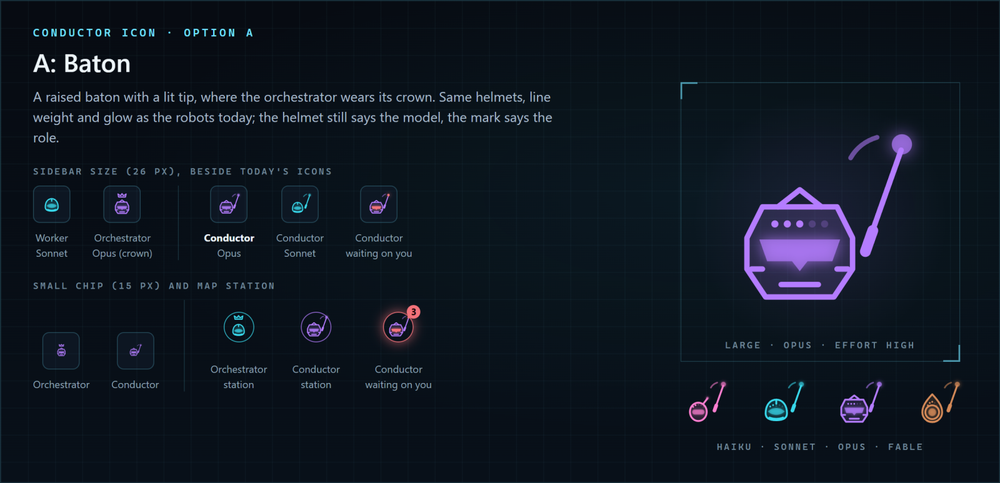
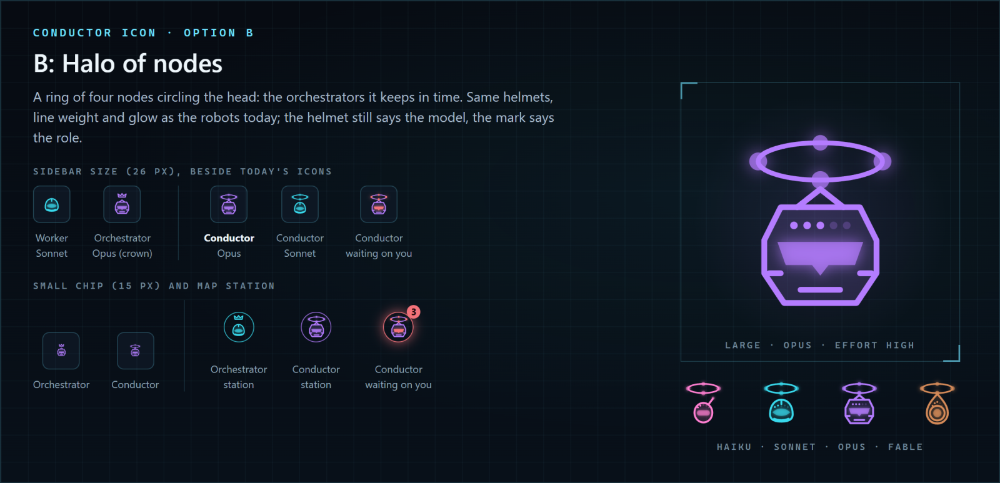
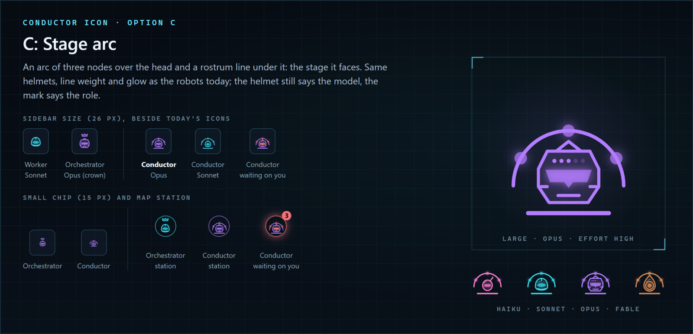

# 0056 What does the Conductor's icon look like?

- Status: open
- Date: 2026-11-13
- Lenses: ui
- Builds on: 0020, 0055

## In short

Pick the Conductor's mark on the robot icon. I recommend B, a halo of four nodes around its head: it still reads at the smallest size and matches the map, where the orchestrators circle the Conductor. Confidence: medium.

For you:

- The helmet keeps showing the model colour; the mark on top shows the role, as the orchestrator's crown does today
- Hard to undo: An icon swap later is a small change

## Context

Matt asked for the Conductor (decision 55) to have its own icon. The worker drew three marks on the existing robot (same 48-grid helmets, line weight and glow as robots.js), each shown at 26 px beside today's worker and crowned orchestrator, at 15 px, as a map station plain and red with a count, large, and on all four model helmets.

## Options

### A: Baton

A raised baton with a lit tip where the orchestrator wears its crown.

*A: baton, at every size and on every model helmet*

- Pro: Says "conductor" at once
- Con: A thin line that gets lost at 15 px
- Effort: Small

### B: Halo of nodes (recommended)

A ring of four glowing nodes circling the robot's head.

*B: halo of nodes, at every size and on every model helmet*

- Pro: Reads at 15 px; echoes the map's ring of orchestrators
- Con: Less literal than the baton
- Effort: Small

### C: Stage arc

An arc of three nodes over the robot, standing on a rostrum line.

*C: stage arc, at every size and on every model helmet*

- Pro: Distinct silhouette
- Con: Busiest of the three at small sizes
- Effort: Small

## Recommendation

B (lean). B stays legible at the smallest size and ties the icon to the map's picture of the Conductor at the centre of its orchestrators.

What would change this: If the halo reads as decoration rather than a role, take A.
