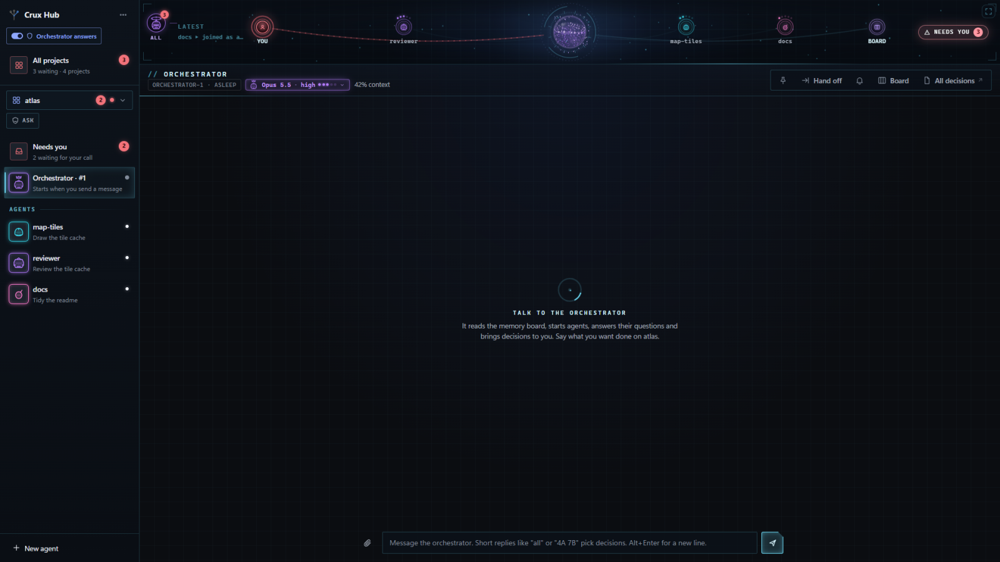
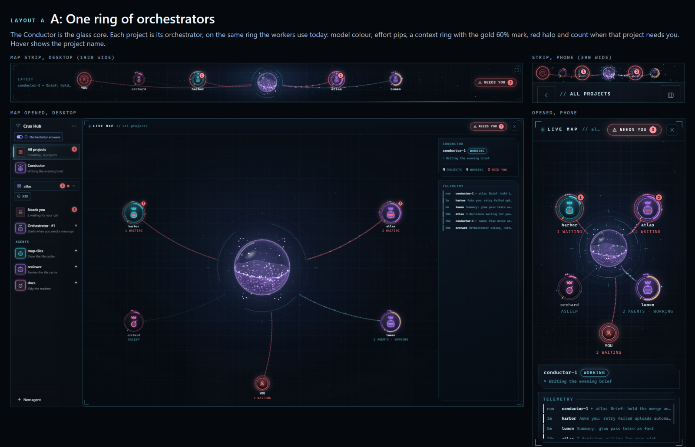
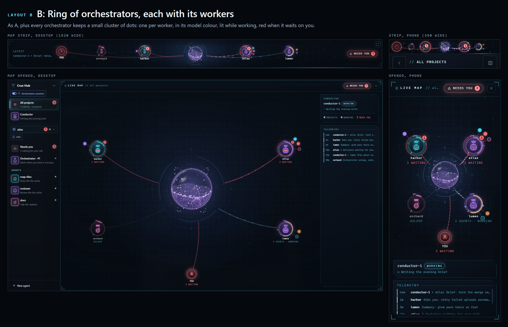
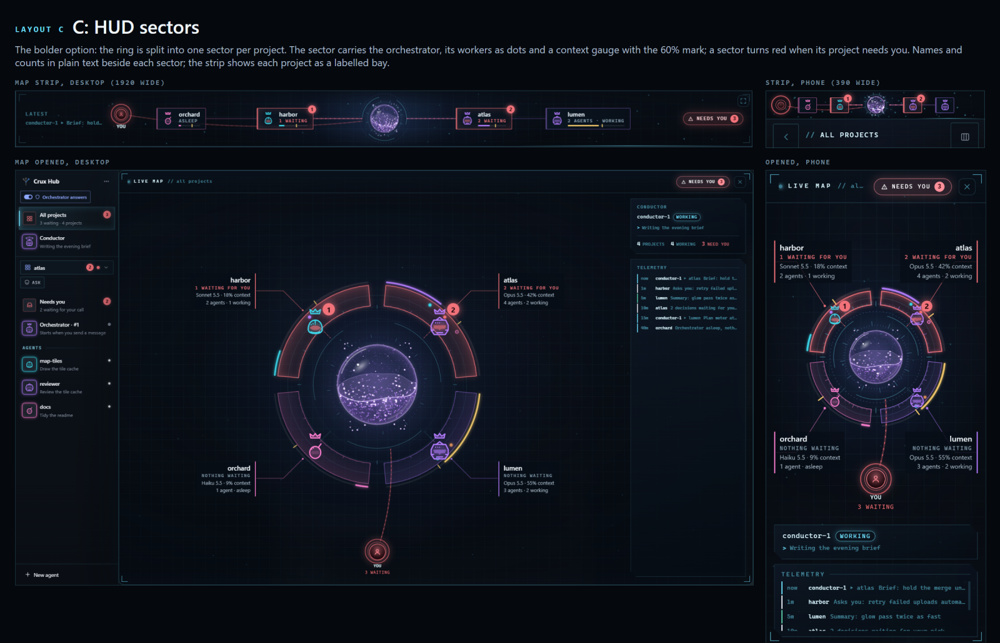

# 0057 What does the live map show when All projects is open?

- Status: open
- Date: 2026-11-13
- Lenses: ui
- Builds on: 0017, 0031, 0033, 0042, 0055, 0056

## In short

Pick how the map shows every project at once, with the Conductor in the centre. I recommend C, one sector per project: each shows its name, how many things wait on you, its orchestrator, worker dots and context as plain text, and turns red when the project needs you. Confidence: medium.

For you:

- Opening All projects swaps the map to the Conductor in the centre with every project around it; clicking a project opens its orchestrator chat, and an ALL button in the strip goes back up
- A project that needs you turns its whole sector red; today only the You station turns fully red, so this widens that rule for this map only
- Hard to undo: Changes decision 42, where the map stayed on one project; going back is a page change only

## Context

Decision 42 made All projects a list column and kept the live map strip (decision 17) on the last project opened, so Matt sees only one project's agents orbiting. He asked for the map in All projects to show the Conductor (decision 55) at the centre with each project's orchestrator attached, coloured when its project needs him. Mockups were made on the real hub page and live map, with fake projects (atlas with 2 waiting, harbor with 1, lumen, orchard) at 1920 and 390 wide. Conflict with decision 31 (red is your call): today only the You station turns fully red and agents get a red count badge; here a waiting project's whole station or sector turns red, on this map only.

## Pictures

*After clicking a project: its own map, with an ALL button to go back up*

## Options

### A: One ring of orchestrators

The Conductor is the glass core; the orchestrators are stations on the existing ring with model colour, effort pips, a context ring with the 60% mark, and a red halo with a count when their project needs you. The board station is dropped; You stays.

*A: one ring, strip and opened map at 1920 and 390 wide*

- Pro: Calmest; closest to today's map
- Con: Project names and counts only on hover; workers not shown
- Effort: Medium

### B: Ring plus worker dots

As A, and each orchestrator has its workers as small dots on a short orbit: model colour, lit while working, red when waiting.

*B: ring plus worker dots, at 1920 and 390 wide*

- Pro: Shows who is busy everywhere at a glance
- Con: Names still behind hover; busier at phone width
- Effort: Medium

### C: HUD sectors (recommended)

The ring splits into one sector per project, holding its orchestrator, worker dots and a context gauge with the 60% mark, with plain-text name, "N waiting for you", model and context. A waiting project's sector glows red. In the strip each project is a labelled bay with a small context bar.

*C: HUD sectors, at 1920 and 390 wide*

- Pro: Everything readable without hovering; boldest HUD look
- Pro: Still fits four projects on a phone
- Con: Most to draw; past about six projects the sectors get thin
- Effort: Medium to large

## Recommendation

C (lean). C takes the HUD look all the way while keeping every name, count and context level as plain text, so you never hover to find out which project needs you. B is the fallback if C feels too busy.

What would change this: If C feels busy in use, or you run more than about six projects, go B.
