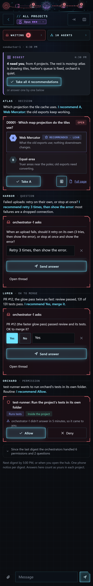
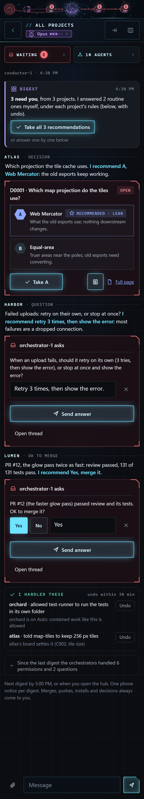
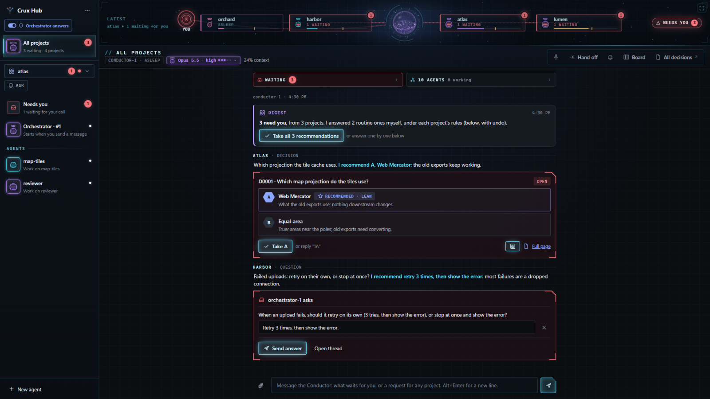
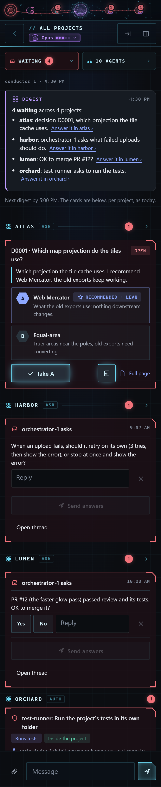

# 0060 How does the Conductor cut down what reaches you?

- Status: open
- Date: 2026-11-14
- Lenses: research and product, ui
- Builds on: 0021, 0031, 0042, 0055, 0059
- Settles: cross-project agent authority = a Conductor above the project orchestrators digests what waits for the human, recommends per item and lets the human answer in place; it settles routine items within each project's own rules with undo; merges, pushes, installs, deletes and decisions always go to the human

## In short

Pick how the Conductor takes work off you instead of relaying it. I recommend B: one digest at a time with a recommendation per item that you answer in place, and the Conductor settles the routine items itself (with undo), so only real calls reach you. Confidence: medium.

For you:

- One digest at a time (at most every 30 minutes, or when you open the hub), grouped by project; tap once per item or take all recommendations; your tap counts as your own answer in that project
- One phone notice per digest instead of one per card; permission requests that need you right away keep their own immediate notice
- With B the Conductor answers routine questions under each project's own rules and shows what it decided, with undo; merges, pushes, installs, deletes and decisions always come to you
- Hard to undo: Widens decision 55: today the Conductor only reads and routes; going back to A or C is a settings change

## Context

Matt, after using the Conductor (decision 55 A): it 'is supposed to be the hive mind that supercharges my ability to manage projects at once, not just send me to individual repos to answer questions and make decisions there. It needs to reduce what's coming into me, not increase it.' Today it relays each card and points to the project. conductor-mock mocked three options on the real All projects page with fake projects (a decision, a question, an OK to merge, a routine permission). The answer counting as Matt's is safe because it is his own tap or reply on the real card, not the Conductor's reading of it; the earlier rule stays that a push, PR or merge OK relayed in the Conductor's own words never counts.

## Options

### A: Digest with answers in place

The Conductor posts one digest at a time, grouped by project, with a one-line summary and its recommendation per item. The real cards sit inside it with the recommendation pre-filled: one tap answers, or take all recommendations. One phone notice per digest. Routine permissions the orchestrators already handle never reach you.

*A: one digest, four items with recommendations, answered in place \(phone\)*

- Pro: Everything in one place, answered without leaving the Conductor
- Pro: No new authority for the Conductor
- Con: Every item still needs your tap, routine ones included
- Effort: Medium: digest timing, cards embedded in a Conductor message, notice batching

### B: A, plus it settles the routine ones (recommended)

As A, and the Conductor answers routine items itself within each project's rules (what that project's orchestrator could answer on its own), listing each in an 'I handled these' box with the rule it used and Undo. Only real calls reach you: decisions, merges, pushes, installs, deletes and anything a rule keeps for you.

*B: three real calls, plus 'I handled these' with reasons and Undo \(phone\)*

*B on the desktop*

- Pro: The only option that cuts what reaches you
- Pro: Every Conductor answer is shown with its reason and can be undone
- Con: New authority: the Conductor answers questions and contained permission requests, so its rules need care and a review
- Con: A wrong routine answer can run before you see it (undo after the fact)
- Effort: Medium to large: A plus answering tools fenced to each project's rules, undo, and tests

### C: Today's relay, batched

One message listing the waiting items with links to answer each in its project; the cards stay in the Waiting drawer.

*C: today's relay batched into one message \(phone\)*

- Pro: Smallest change
- Con: No shorter than today; still sends you to each project
- Effort: Small

## Recommendation

B (lean). B is what you asked for: fewer things reach you, each with a recommendation and one tap, and the routine ones are handled with a visible reason and undo. The hard stops stay yours in every option.

What would change this: If you'd rather see every item before anything is answered, take A; B can be switched on later.
