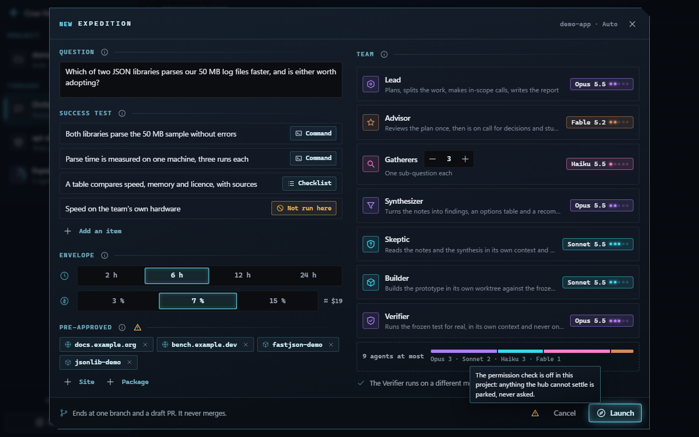
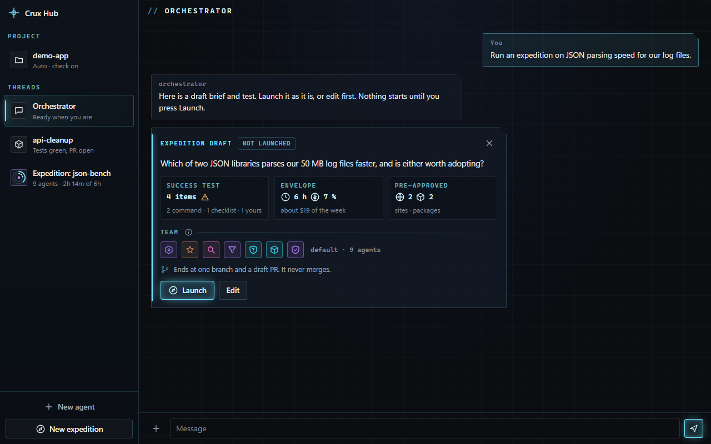
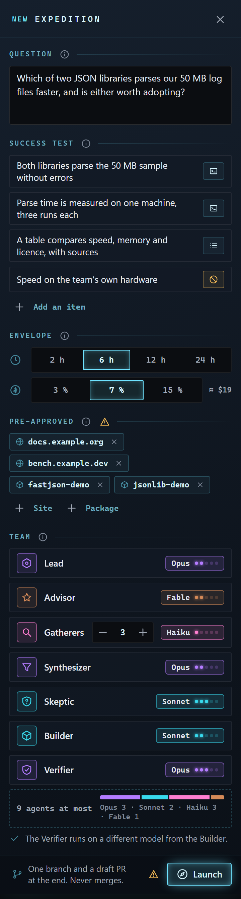
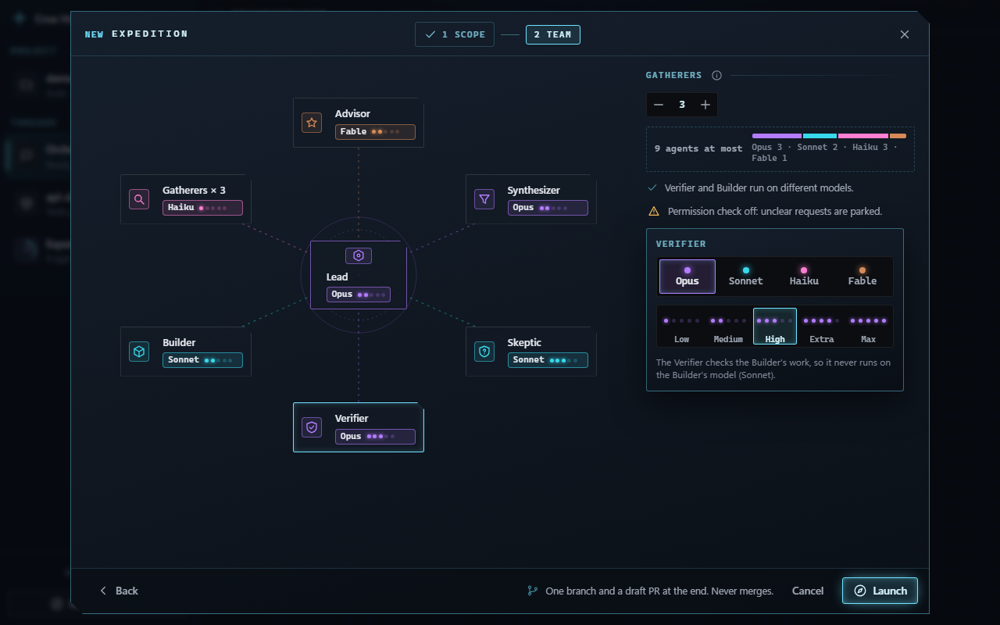

# 0070 What does launching an expedition look like: setting the scope and assembling the team?

- Status: open
- Date: 2026-11-16
- Lenses: ui
- Builds on: 0012, 0020, 0033, 0068

## In short

Should launching be one panel, with Scope on the left and Team on the right, opened from a New expedition button or from the orchestrator's draft card? I recommend that: one form, two ways in, and a one-tap Launch when the draft is fine.

For you:

- Say 'run an expedition on X' in a thread: the orchestrator drafts the brief and test as one card with Launch and Edit
- Edit, or the New expedition button, opens the same panel: question, success test, time and budget, pre-approved sites and packages, and the team with each role's model and effort
- Team changes apply to that launch only; lasting changes go in the role files

## Context

Matt (2026-11-16): launching an expedition is defining a project scope and assembling the team. Spec sections 5 and 3 (memo M044). Mockups use fake, neutral data. The advisor checkpoint agreed with A plus C's entry.

## Options

### A: One panel, plus the draft card in the thread (recommended)

Scope and Team side by side in one panel (one column on the phone), reached from a New expedition button or from the Edit on the orchestrator's draft card, which can also launch at once.

*A: one panel, Scope left and Team right*

*A's other way in: the orchestrator's draft card with Launch and Edit*

*A on the phone: one column*

- Pro: Everything visible at once; quickest path when the draft is right; closest to the hub's New agent dialog
- Con: A dense panel on a phone (one long column)
- Effort: Medium

### B: Two steps, with a crew picture

Step 1 Scope; step 2 'Assemble the team': the roles drawn around the Lead as on the map; tap one to change its model and effort.

*B: step 2, the team around the Lead*

- Pro: The nicest look; teaches the cluster shape
- Con: Two steps; repeats what the map shows; more to build
- Effort: Medium to large

## Recommendation

A (firm). A: one form, reached from the chat or a button; B's crew picture can be added inside the same panel later.

What would change this: If you want the team step to feel like assembling a crew, take B; nothing else in the plan changes.
