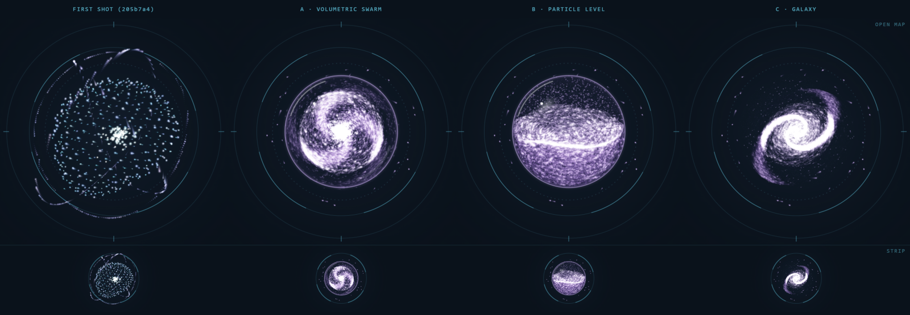
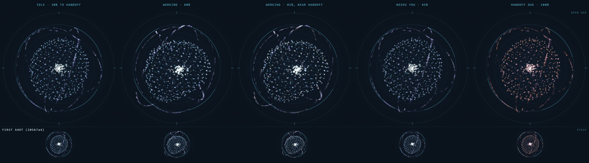
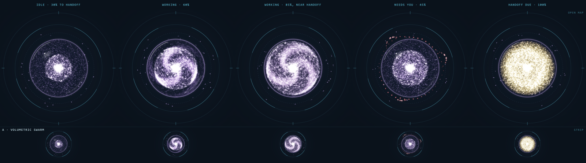
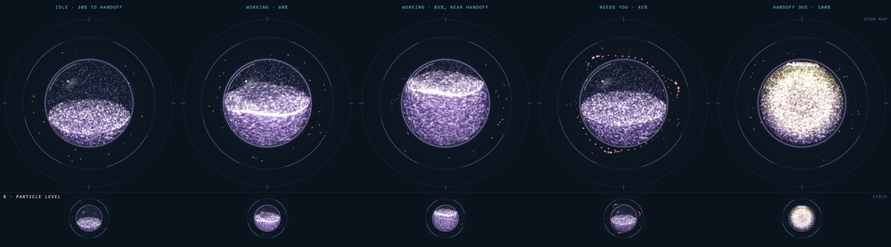
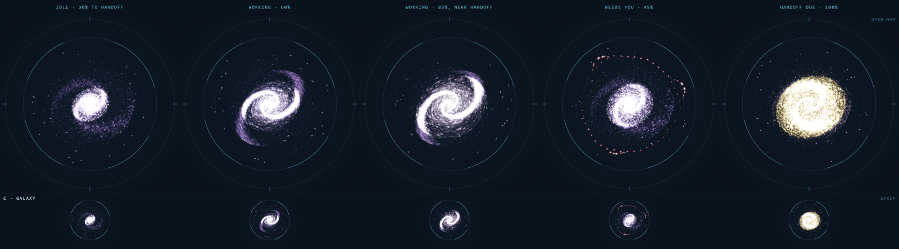

# 0076 What should the live map's core look like: a full particle swarm, a particle level, or a galaxy?

- Status: decided
- Date: 2026-11-17, decided 2026-11-17
- Lenses: UI
- Builds on: 0017, 0033
- Settles: live map core look = dense volumetric particle swarm filling the sphere; context as the lit core's size, gold near handoff; motion in the vertex shader; tens of thousands of points on desktop, about 10,000 on a phone

## In short

Should the live map's core become a dense swarm of particles that fills the whole sphere, with a bright centre that grows as an agent's context fills, in place of today's painted liquid? I recommend it: it fills the empty middle, drops the fake-looking liquid, and is closest to the first core you liked.

For you:

- The sphere is always full of moving particles (about 80,000 on your PC, about 10,000 on the phone, against about 1,200 today); context shows as how much of it is lit, turning gold near handoff
- Working shows as a faster swirl with arms, idle as a slow drift; red flare, sparks and streams stay as they are
- You can open the mockup page on your PC and watch all three move, with buttons to test the frame rate
- Nothing is hard to undo: the old core stays in git history

## Decision

**A: Volumetric swarm.** The whole sphere is always full of particles in slow orbital flow. Context is how much is lit: a bright core with a white nucleus grows outward from the centre inside a dim haze of the model's colour; gold over the last fifth, full and pulsing gold at handoff. Working is a faster three-arm vortex, idle a slow drift. Glass kept only as a thin rim and highlight.

Reason: Matt watched the live mockup page: "The swarm is great, let's do that."

## Context

Matt (2026-11-17): the first live-map core was great, but now the particles are hardly there in the middle and a fake-looking liquid sloshes; he wants to go all in on particles. A Fable review found that every particle above the liquid level is pushed onto the glass and drawn almost invisible (half the budget), the liquid itself is painted 2D canvas fills rather than particles, the particle budget only ever drops after a slow spell, the strip core is dimmed further, and the renderer asks for the low-power GPU and recomputes every particle in JavaScript each frame, which caps it near 1,200. The first core (commit 205b7a4) was a cyan atom of 760 particles that carried almost no context. A solver built a mockup page (hub/mockups/core-particles.html on feat/core-particles) with motion in the vertex shader, 60,000 points per core, half-float glow, on Matt's RTX 4070 Ti SUPER, in five states (idle 30%, working 60%, working 85%, needs you, handoff due) at open-map and strip size. Particle budgets beyond the mockup are an estimate until Matt runs the page's frame-rate buttons. This supersedes the glass reservoir look from memo M013 and lifts the pack's 'modest particle count' line.

## Pictures

*All four side by side at working 60%: A swarm, B level, C galaxy, and the first core*

*Reference: the first core you liked, same five states*

## Options

### A: Volumetric swarm (chosen) (recommended)

The whole sphere is always full of particles in slow orbital flow. Context is how much is lit: a bright core with a white nucleus grows outward from the centre inside a dim haze of the model's colour; gold over the last fifth, full and pulsing gold at handoff. Working is a faster three-arm vortex, idle a slow drift. Glass kept only as a thin rim and highlight.

*A: volumetric swarm, five states \(idle 30%, working 60%, working 85%, needs you, handoff due\), open map above and strip below*

- Pro: Fills the middle at every context level
- Pro: Closest to the first core's sparkle and nucleus
- Pro: Context reads clearly from 30% to 60%
- Con: 60% against 85% is subtler while working (gold helps near the end)
- Effort: Medium

### B: Particle level

Keeps today's idea of a level, with the painted body removed: particles below the level are dense, those above become a thin mist, and the surface is just where the cloud gets dense.

*B: particle level, same five states*

- Pro: Reads at a glance as a level, closest to today
- Pro: Smallest change
- Con: The top half is still sparse at low context, which is the thing you dislike
- Effort: Small

### C: Galaxy

A tilted disc with spiral arms and a halo; context is the size of the bright centre bulge.

*C: galaxy, same five states*

- Pro: The most striking picture
- Pro: Working against idle shows clearly
- Con: Context is the hardest to read
- Con: Drops the sphere and the glass, least like the first core
- Effort: Medium

## Recommendation

A (medium). A: a full volumetric swarm with a lit core that grows with context, built first as a quick swap of the painted liquid and then moved fully onto the GPU.

What would change this: If the frame-rate buttons show your PC or phone struggling at the planned counts, lower the counts; if context is hard to read in daily use, borrow B's dense surface line.
