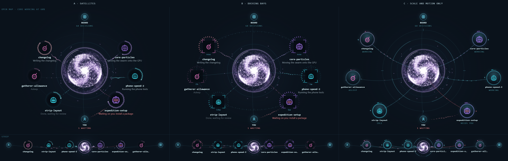
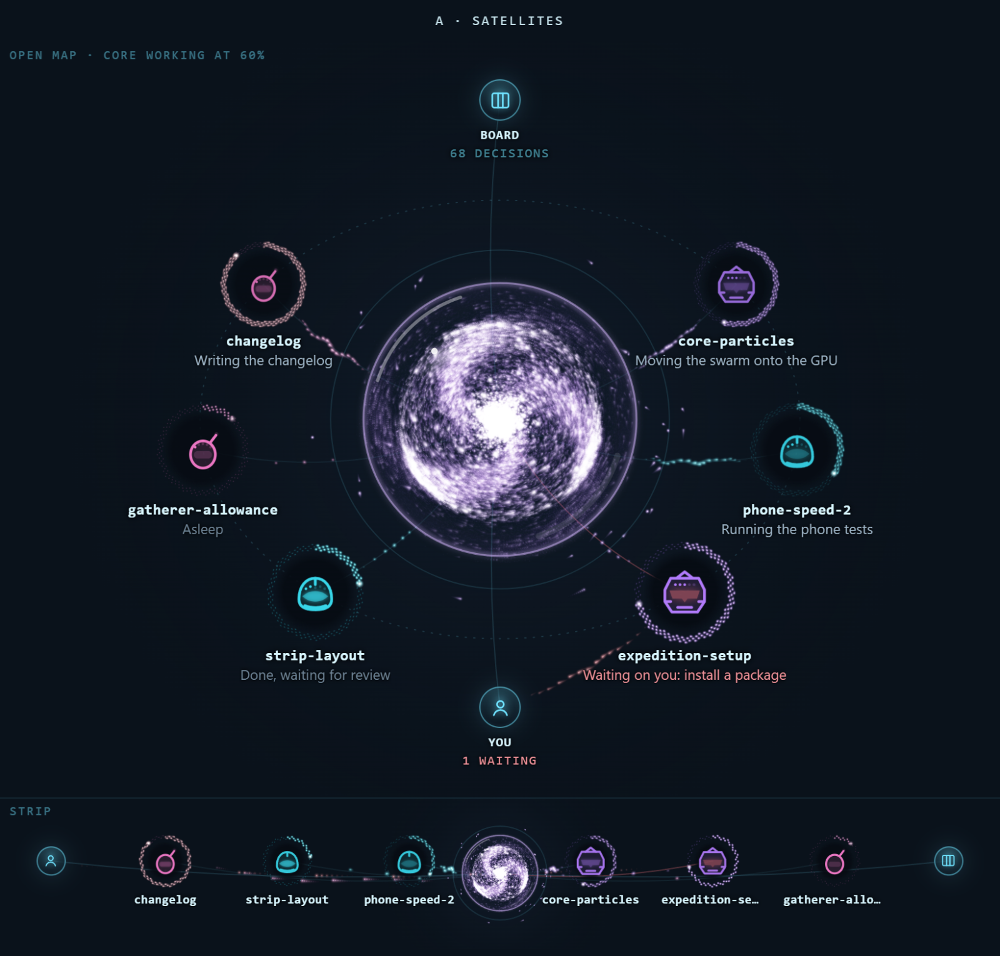
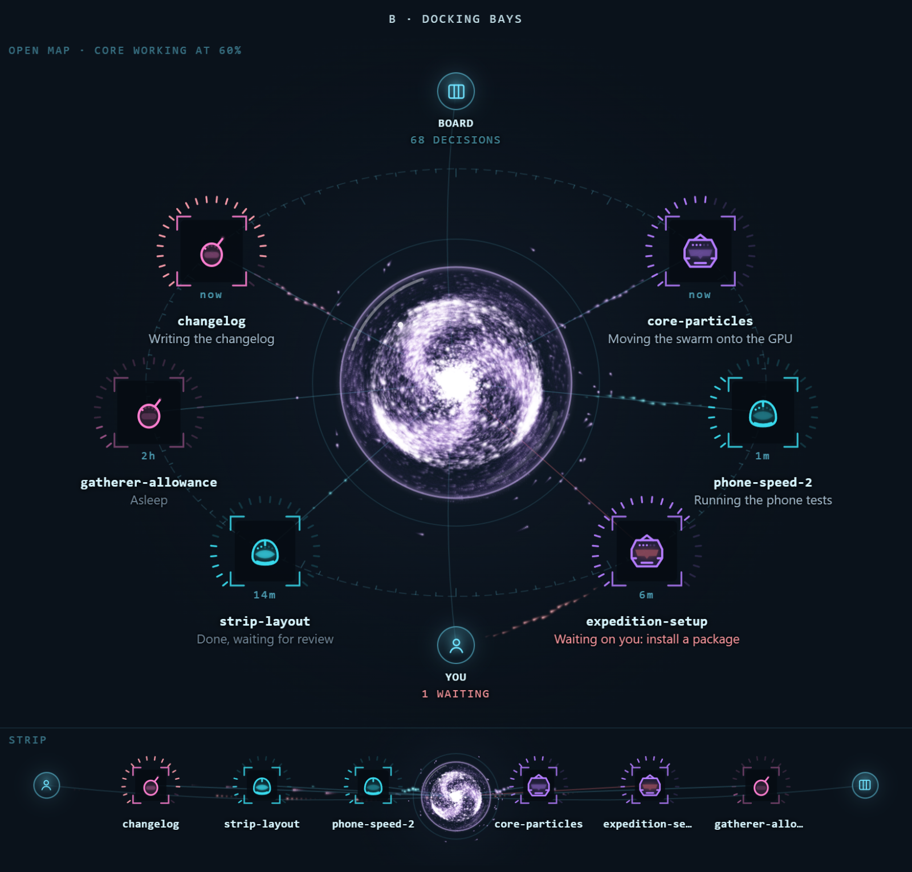
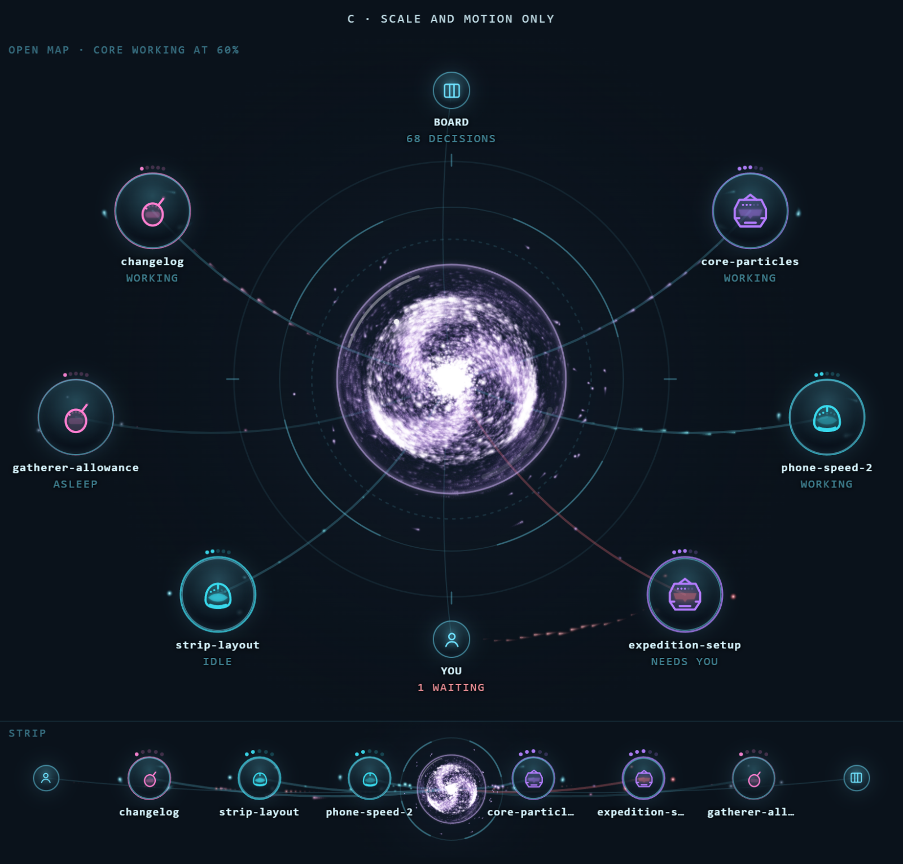

# 0077 How should the worker robots around the live map's core look?

- Status: decided
- Date: 2026-11-17, decided 2026-11-17
- Lenses: UI
- Builds on: 0017, 0033, 0076
- Settles: live map worker stations = robots as satellites of the core: about 44 px, tight tilted orbit, a particle ring per worker showing its context, permanent particle stream spokes, plain activity line under the name

## In short

Should the worker robots become satellites of the particle core, bigger and closer, each with its own ring of particles showing how full its context is, joined to the core by a constant particle stream? I recommended it: it makes each worker readable at a glance and ties them to the swarm.

For you:

- Robots draw at about 44 px with their own effort marks, on a tighter orbit around a slightly bigger core
- Each robot's particle ring fills with its context and turns gold near handoff; it spins faster when working and breathes when resting
- The line to the core is always a particle stream: dense when working, sparse when resting, red toward you when it needs you
- Names in white with a short plain line of what each is doing, no shouting caps

## Decision

**A: Satellites of the core.** Core grown, orbit pulled in to about 30% of the width as a tilted ellipse, front stations larger and brighter. Robots at about 44 px with their own effort marks. Each worker has a particle ring in its model colour lit for its share of context, gold near handoff, faster when working, breathing when resting. Each spoke is a permanent particle stream. Name in white plus one plain activity line.

Reason: Matt on the live mockup: "I like A." He also asked to remove the decision count under the board icon.

## Context

Matt (2026-11-17): the robots in the live view 'fall flat', though their icons are cool. A Fable review named why: icons drawn at about 21 px (12 px in the strip) so their effort marks never show; flat discs beside a lit 3D core; asleep workers frozen; hairline spokes with streams only when working; workers orbiting far out from a small core; identical workers look identical; ASLEEP in caps is the loudest label. A solver added three looks to the live mockup page around the new swarm core (decision 76), with six workers in mixed states. The robot drawings in robots.js are kept unchanged.

## Pictures

*All three robot looks around the swarm core*

## Options

### A: Satellites of the core (chosen) (recommended)

Core grown, orbit pulled in to about 30% of the width as a tilted ellipse, front stations larger and brighter. Robots at about 44 px with their own effort marks. Each worker has a particle ring in its model colour lit for its share of context, gold near handoff, faster when working, breathing when resting. Each spoke is a permanent particle stream. Name in white plus one plain activity line.

*A: satellites with particle rings and streams*

- Pro: Most alive, and each worker's context reads at a glance
- Pro: Ties the stations to the swarm
- Con: Most to build of the three
- Effort: Medium

### B: Docking bays

Robots in angular HUD brackets on a dashed ring, each bay with a tick gauge for context and minutes since it last acted; straight spokes with streams when working.

*B: docking bays with gauges*

- Pro: Most instrument-like, very legible numbers
- Con: More static; boxes the robots in
- Effort: Medium

### C: Bigger and moving only

Today's layout and labels, robots at 40 px with effort marks, orbit dots that never freeze, light streams on every spoke.

*C: today's layout, bigger and moving*

- Pro: Safe and smallest
- Con: Still floats apart; no context per worker; ASLEEP still loud
- Effort: Small

## Recommendation

A (medium). A: satellites with their own particle rings and permanent streams to the core.

What would change this: If the rings make a busy map hard to read with many workers, thin them or show them only on hover in the strip.
