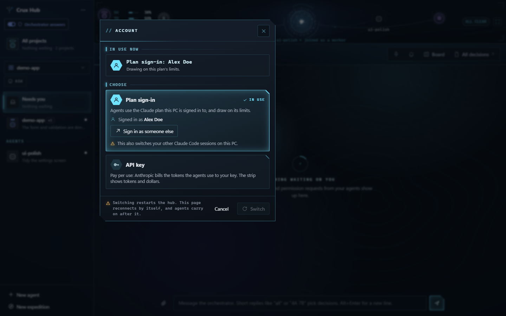
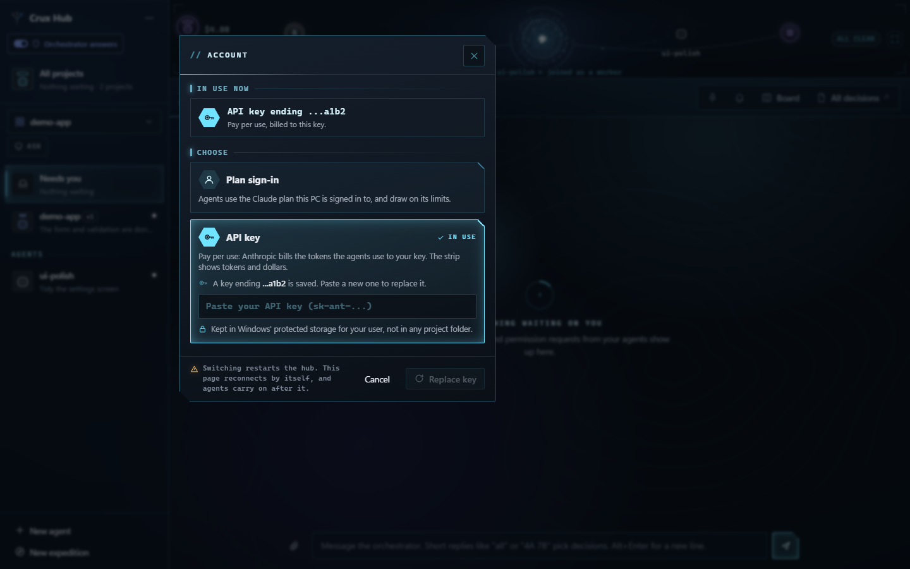
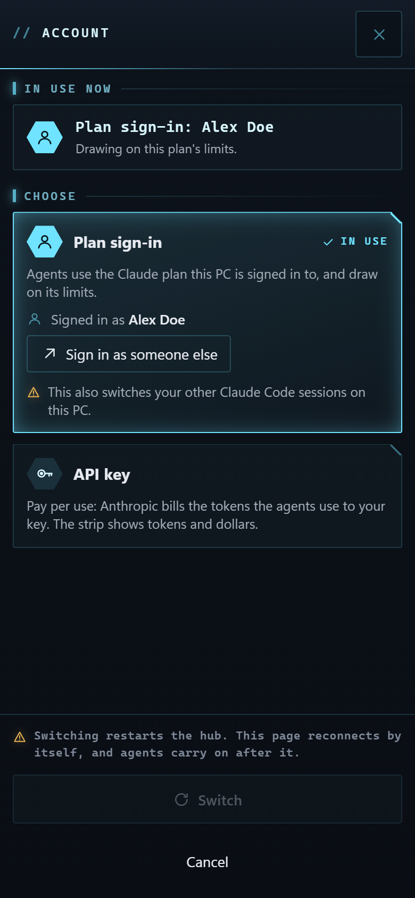
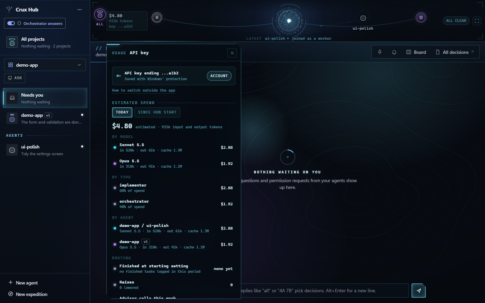

# 0078 Where do you choose which account the hub's agents run on?

- Status: decided
- Date: 2026-11-17, decided 2026-11-17
- Lenses: UI, architecture
- Builds on: 0036, 0038, 0044, 0048
- Settles: agent account selection = chosen in the hub's UI (plan sign-in or API key), one account for the hub; API key kept in the OS's per-user protected storage, never in a project or repo; switching restarts the hub

## In short

Should the hub get an Account card where you see which account the agents use and switch between a plan sign-in and an API key, with the key kept in Windows' protected storage? I recommend it: switching today means environment variables and a terminal sign-in.

For you:

- Click the usage meters to open the Account card: it shows the account in use and lets you switch, with a Cancel exit
- Switching restarts the hub, and running agents stop their turn and carry on afterwards
- Setup: A pasted API key is kept in Windows' protected storage for your user, never in a project folder or the repo
- Hard to undo: Switching the plan sign-in also switches Claude Code for your other sessions on this PC until you switch back

## Decision

**A: Account card, one account for the hub.** An Account card opened from the usage meters: shows the account in use, chooses Plan sign-in (with Sign in as someone else) or API key (paste field), kept in Windows' protected storage; Switch restarts the hub. Plan meters for a plan; tokens and dollars for a key.

## Context

Matt (2026-11-17) is testing how the hub works on another plan for a colleague. Today agents use the PC's Claude Code sign-in; with ANTHROPIC_API_KEY plus CRUX_HUB_USE_API_KEY=1 set before start they use an API key instead (hub/README.md, lib/agent.mjs; the API-key start has not been tested end to end). Usage shows as plan meters in the strip (decision 36), which only exist for a plan sign-in. Per-project settings live on a card opened from each project's level chip (decision 44). A plan sign-in is meant for its owner; a colleague is best tested on their own machine or Windows user, or with an API key.

## Options

### A: Account card, one account for the hub (chosen) (recommended)

An Account card opened from the usage meters: shows the account in use, chooses Plan sign-in (with Sign in as someone else) or API key (paste field), kept in Windows' protected storage; Switch restarts the hub. Plan meters for a plan; tokens and dollars for a key.

*A: Account card on a plan sign-in \(built, fake data\)*

*A: Account card on an API key \(built, fake key\)*

*A: the card on a phone, plan sign-in*

*A: usage panel on an API key: tokens and dollars instead of plan meters*

- Pro: No terminal or environment variables; you always see which account is billing
- Pro: Key never sits in a file in a project or the repo
- Con: One account for all projects at a time
- Con: A plan switch also changes your other Claude Code sessions on this PC
- Effort: Medium

### B: A, plus an account per project

As A, and each project's card can use a different API key, with a badge on its thread when it differs from the hub's.
- Pro: A colleague's or client's work can bill to its own key
- Con: More to build and test; usage and budgets split by key
- Effort: Large

### C: Show the account only

The usage panel says which account is active and links to how to switch outside the app.
- Pro: Smallest; nothing new holds a key
- Con: Switching stays a terminal job
- Effort: Small

## Recommendation

A (medium). A: one Account card for the hub, key in Windows' protected storage. Per-project keys (B) can come later if a project really needs its own bill.

What would change this: If a project must bill to someone else's key while others run on yours, take B.
