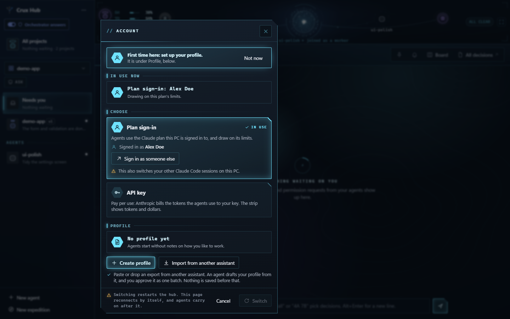
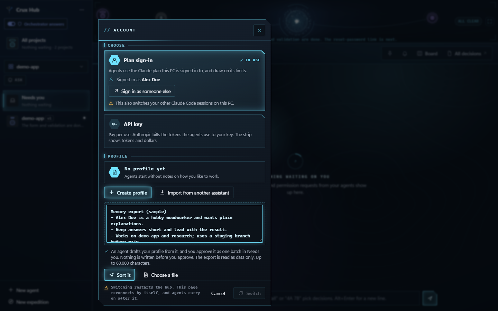
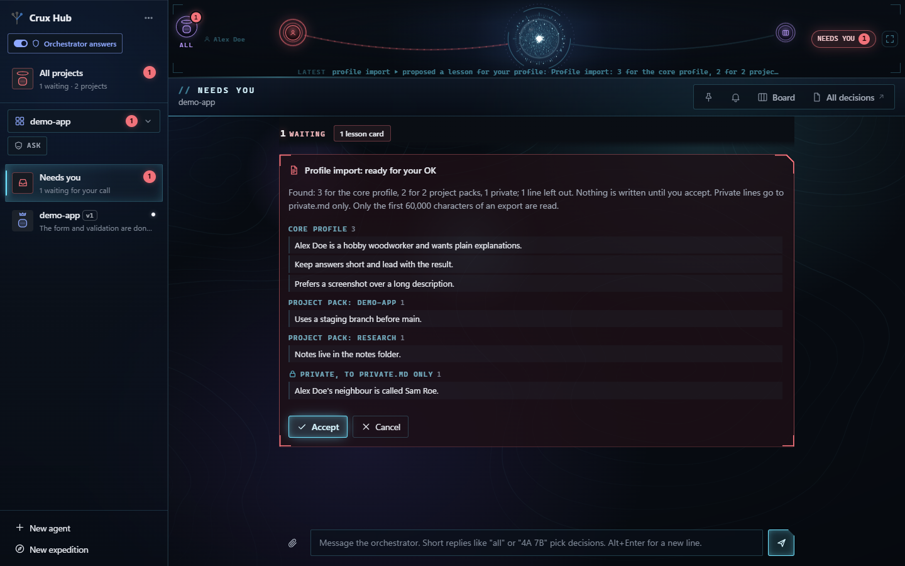

# 0079 How does a new user get a memory profile?

- Status: decided
- Date: 2026-11-17, decided 2026-11-17
- Lenses: UI, research and product
- Builds on: 0013, 0014, 0015, 0078
- Settles: new user profile setup = Profile section in the hub's Account card: create a blank private profile from the template on first run (home crux folder as a local private git repo), optional import of another assistant's memory export drafted by an agent and approved as one batch

## In short

Should the new Account card get a Profile section that creates a private profile on first run and can turn an export from another assistant into a first draft for the user to approve? I recommend it: today a new user starts with no profile unless they find a template folder and copy it by hand.

For you:

- Account card gains a Profile section: it shows whether a profile exists, with Create and Import buttons
- On first run the hub shows one small prompt pointing there, with a Not now exit
- Your own profile is untouched: it already exists, so you only see its status
- Setup: An import is drafted by an agent and lands as one batch you approve, like core lessons today

## Decision

**A: Create plus import, in the Account card.** A Profile section in the Account card. Create makes ~/crux/profile from the template (core, pack index, empty private file) and makes ~/crux a local private git repo with no remote. Import takes a pasted or dropped memory export from another assistant; an agent sorts it into core, packs and private, treating it as data, and the result waits as one batch for approval. First run shows one small prompt pointing there.

## Context

Matt (2026-11-17): a new user who downloads Crux gets no memory setup. Today the public repo ships profile-template/ (blank core.md and packs/_index.md) and a README saying to copy it into ~/crux/profile/ and keep that folder private (decisions 14, 15). Nothing in the hub's setup mentions it. Matt's own profile was seeded from his Claude.ai memory export and older notes; a newcomer's grows only from lessons, and it is untested whether propose_lesson works with no profile folder at all. Matt wants this to live in the Account card from decision 78.

## Options

### A: Create plus import, in the Account card (chosen) (recommended)

A Profile section in the Account card. Create makes ~/crux/profile from the template (core, pack index, empty private file) and makes ~/crux a local private git repo with no remote. Import takes a pasted or dropped memory export from another assistant; an agent sorts it into core, packs and private, treating it as data, and the result waits as one batch for approval. First run shows one small prompt pointing there.

*A: Profile section in the Account card, new user, with the first-run prompt*

*A as built: import from another assistant \(fake export\)*

*A as built: the one batch card you approve in Needs you*

- Pro: A newcomer gets a useful profile on day one, as Matt did
- Pro: Nothing joins the profile without the user's yes
- Con: The import step costs one agent run and needs care with what the export contains
- Effort: Medium

### B: Create only

As A without import: Create makes the blank profile, and lessons fill it over time.
- Pro: Smallest; no agent run, nothing pasted in
- Con: Starts empty; agents know nothing about the user for weeks
- Effort: Small

### C: A, plus a short first-run interview

As A, and for users with no export: a five-minute chat with an agent (role, how they like work approved, tone, UI likes) that drafts the core for approval.
- Pro: Everyone starts with a real core, export or not
- Con: Most to build; an interview can feel like homework
- Effort: Large

## Recommendation

A (medium). A: Create and Import in the Account card's Profile section, everything approved as one batch. An interview (C) can follow if users without an export start too empty.

What would change this: If most new users have no export to import, add the interview (C).
