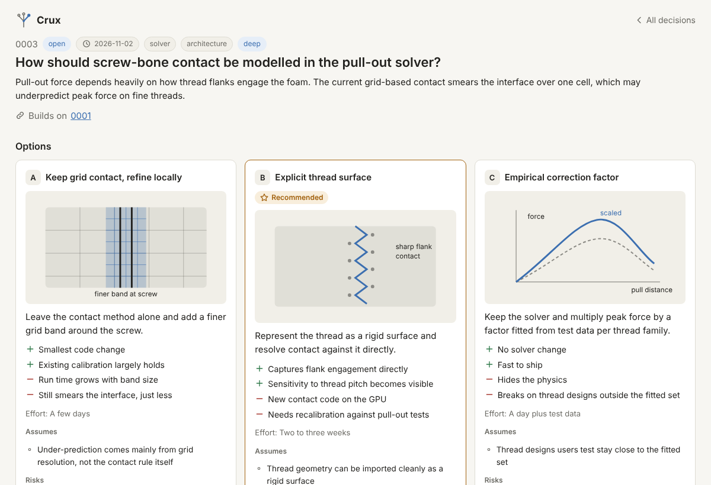
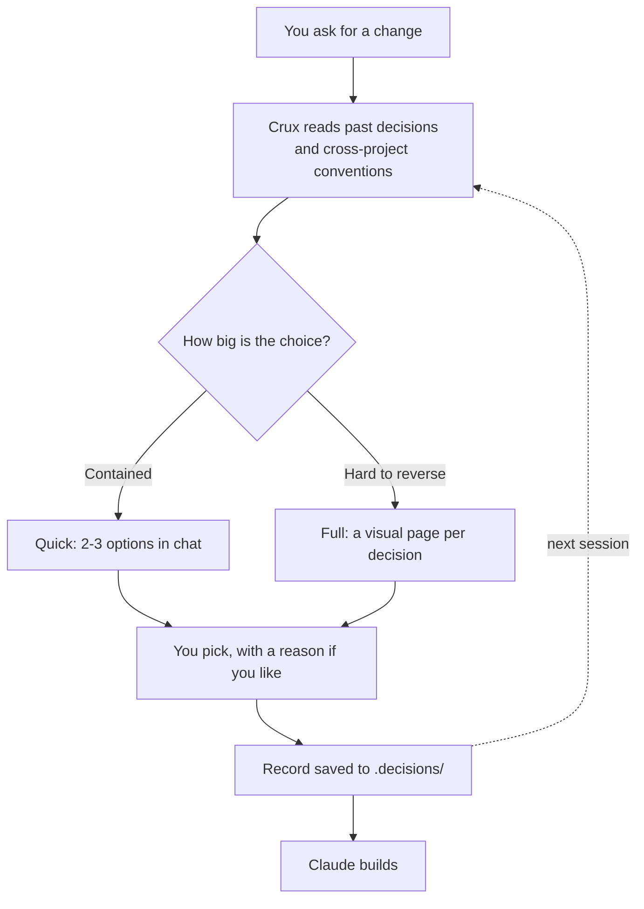
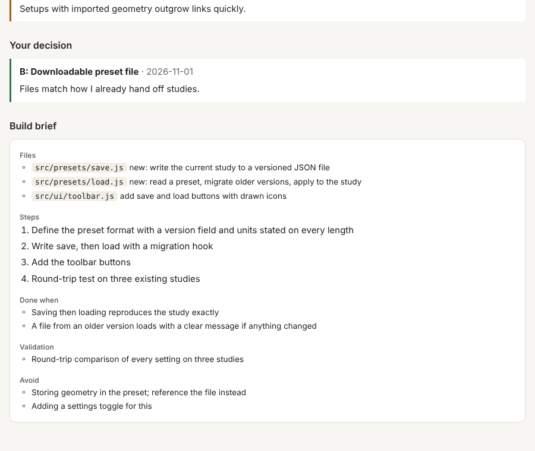
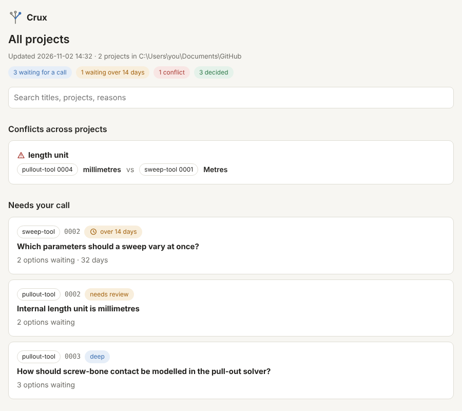

<p align="center"></p>

<h1 align="center">Crux</h1>

<p align="center"><b>Find the crux. See the options. Make the call.</b><br>
A lightweight decision layer for Claude Code.</p>

---

AI coding tools make dozens of decisions for you while you aren't looking: the data model, the solver method, where state lives, what the screen looks like. Crux stops at the handful that matter, shows you the options as pictures, waits for your pick, and keeps a record that every later session reads before planning.

Claude does the work around the decision. You make the call.

<p align="center"></p>

## How it works



- **Quick** for contained questions: two or three options in chat, a recommendation, you reply with a letter.
- **Full** for choices that are hard to reverse: three to five ranked decisions, each on its own page with a sketch per option, specific pros and cons, scored criteria, and a recommendation with a confidence level.
- **Deep**, added to either, researches each option in parallel (web and code), cites sources, and lists assumptions, risks and estimates with their basis. After you pick, it writes a **build brief** for the session that builds it.

<p align="center"></p>

## Commands

| You type | What happens |
| --- | --- |
| `/crux quick presets in the URL or a file` | Two or three options in chat, you reply with a letter |
| `/crux full plan the subsidence fork` | Three to five ranked decisions, one visual page each |
| `/crux deep plan the subsidence fork` | Full, plus research, sources, risks, estimates and a build brief |
| `/crux quick deep presets in the URL or a file` | One researched decision on a page |
| `/crux challenge 0003` | Claude argues against your pick; you keep it or reopen it |
| `/crux all` | Summary of what is waiting in every project, plus conflicts |
| `/crux-dig` or `/crux-dig src/solver` | Reads existing code and drafts the decisions already baked into it, for you to confirm |

Crux also steps in on its own, in quick mode, when Claude is about to make an architecture-level choice: a new dependency, a data model change, a solver or physics change, a change across several modules, or a research or product direction.

## Lenses

Before building options, Crux loads the checklists that fit the work. Each lists the decisions that tend to hide in that kind of work, the red flags to raise unasked, and the kind of sketch that shows the difference.

| Lens | For |
| --- | --- |
| Architecture | modules, dependencies, where computation runs, loading |
| Data model | data layout, units, precision, file formats, versioning |
| Solver and physics | method, material model, boundary conditions, convergence, calibration, validation |
| UI | layout, controls, defaults, feedback; house UI rules built in |
| Research and product | the question, method, standards, what would kill the idea, what to build next |

## What lands in each repo

```
.decisions/
  index.html                  every decision: waiting, decided, history
  0003-contact-model.json     the source Claude edits
  0003-contact-model.html     the visual page
  0003-contact-model.md       short readable record that later sessions read
```

Pages open in any browser, offline. Pick on the page with "Copy pick for Claude", or just type the letter in chat.

## Across all your projects

Every time a decision changes, Crux refreshes one page covering every repo you have pulled down, plus a short conventions list that Claude reads before planning.

<p align="center"></p>

- **Waiting for a call** across all projects, oldest first, with anything over two weeks flagged.
- **Conflicts**: when two projects settle the same question differently (millimetres in one, metres in another), it shows at the top.
- **Conventions** each project has settled, so a new tool doesn't quietly contradict an old one.

## Install

See [INSTALL.md](INSTALL.md). Short version on Windows: clone this repo into `Documents\GitHub` with GitHub Desktop, then link the two skill folders into `C:\Users\<you>\.claude\skills\` so a pull updates Crux everywhere.

To see the pages before installing, open [example/demo-decisions/index.html](example/demo-decisions/index.html) after cloning. The example content is illustrative and its sources are placeholders.

## Design rules

- Nothing is built, edited or installed until you pick.
- Pages never scroll sideways and use drawn icons only.
- No toggles: everything is shown, ordered by what matters.
- Claims without a source are labelled as Claude's judgment.
- Small on purpose: about 400 lines of instructions, a few templates, and a page builder with no dependencies.

## License

[MIT](LICENSE)
