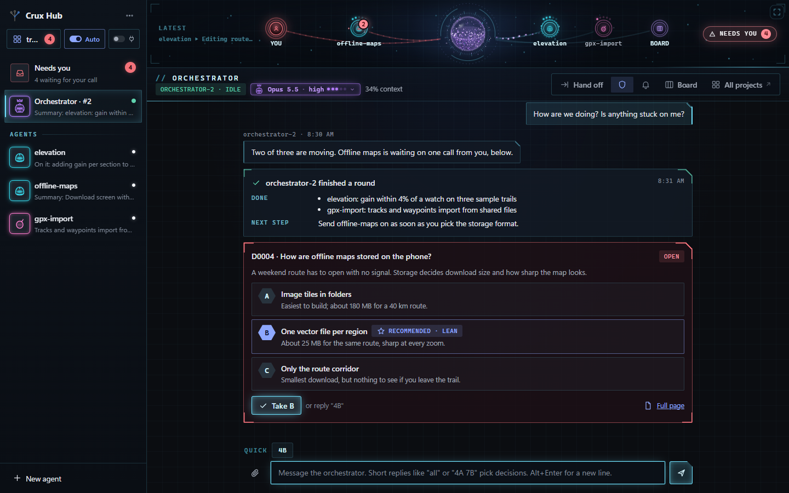

<p align="center"></p>

<h1 align="center">Crux</h1>

<p align="center"><b>Find the crux. See the options. Make the call.</b></p>

---

Crux is a decision skill for Claude Code: it stops at the few choices that matter, shows you the options as pictures, waits for your pick, and keeps a record every later session reads. Crux Hub is a small chat app for running several Claude agents at once from your desk or your phone, built on the same decision records. Claude does the work around the decision. You make the call.

<p align="center"></p>


## Try the skill

1. Clone this repo: `git clone https://github.com/mshomper/crux.git` (or use GitHub Desktop).
2. Link or copy the `crux` and `crux-dig` folders into your Claude Code skills folder, `~/.claude/skills/` ([INSTALL.md](INSTALL.md) has the exact commands).
3. In a new Claude Code session, type `/crux quick` followed by a question, for example `/crux quick should presets live in the URL or a file?`

To see what the pages look like first, open [example/demo-decisions/index.html](example/demo-decisions/index.html) after cloning.

## Run the Hub

You need Node 20 or newer, git, and your own Anthropic API key. The GitHub CLI (`gh`) and Tailscale are optional.

```bash
cd crux/hub
npm install
# PowerShell:  $env:ANTHROPIC_API_KEY = "sk-ant-..."; $env:CRUX_HUB_USE_API_KEY = "1"
# Mac/Linux:   export ANTHROPIC_API_KEY=sk-ant-... CRUX_HUB_USE_API_KEY=1
npm start -- /path/to/your/project
```

Then open http://localhost:4747. API use is billed per token by Anthropic.

**Desktop app (Windows):** a window and tray icon on top of the Hub that starts it for you and can start with Windows. Set up the Hub once as above, then download `Crux Hub_<version>_x64-setup.exe` from [GitHub Releases](https://github.com/mshomper/crux/releases/latest) and run it (per-user, no admin). It is unsigned, so Windows may show "Windows protected your PC": choose More info, then Run anyway. Developers can build it from source: see [app/README.md](app/README.md).


## Learn more

- https://crux.notarobot-eng.com: what Crux and the Hub do, with pictures
- [INSTALL.md](INSTALL.md): installing the skill, every command, how the records work
- [hub/README.md](hub/README.md): the Hub in full, including phone access and permissions

## Status

Early software. Hub version 0.17. Built and used on Windows first; Mac and Linux are untested. Made for one person, running on your own PC.

## License

[MIT](LICENSE)
