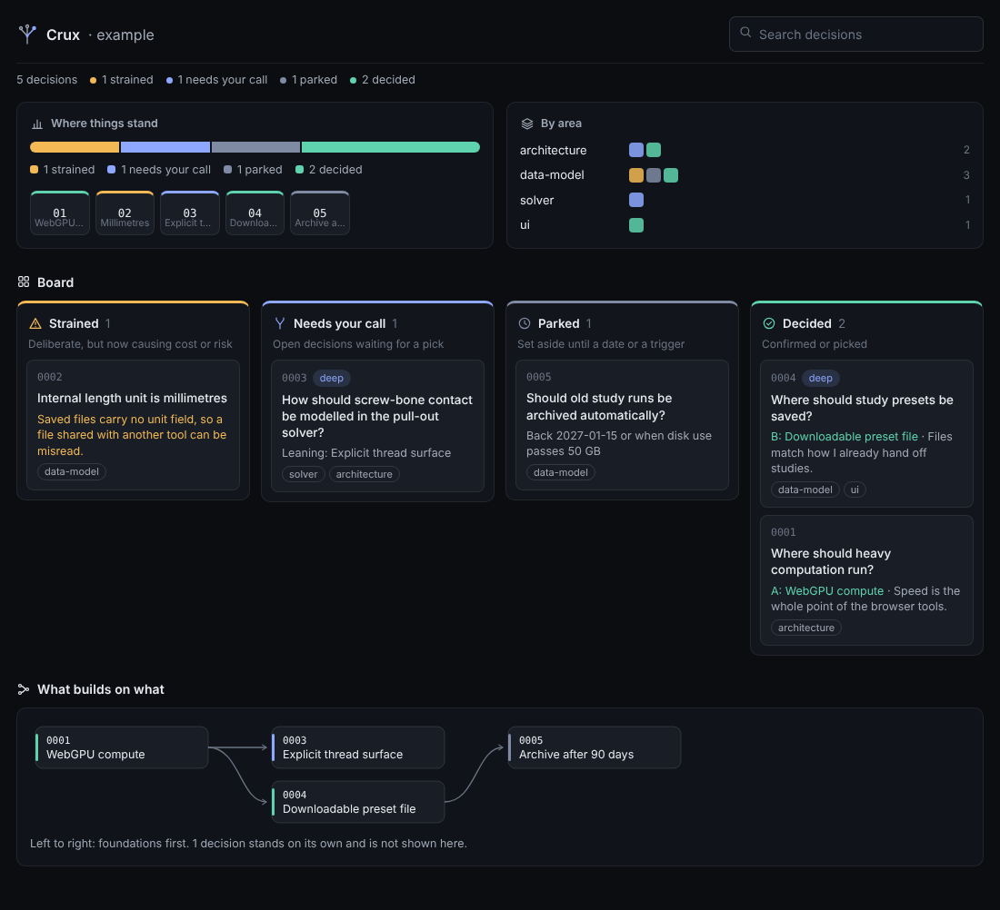
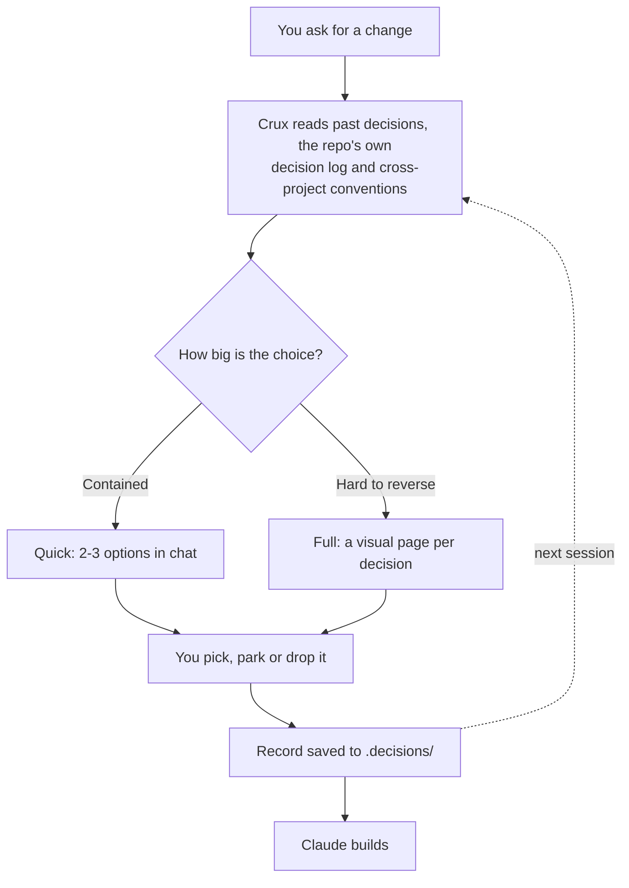
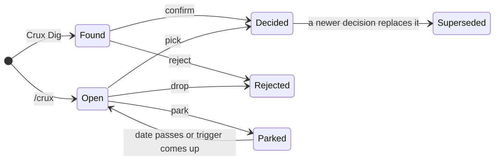
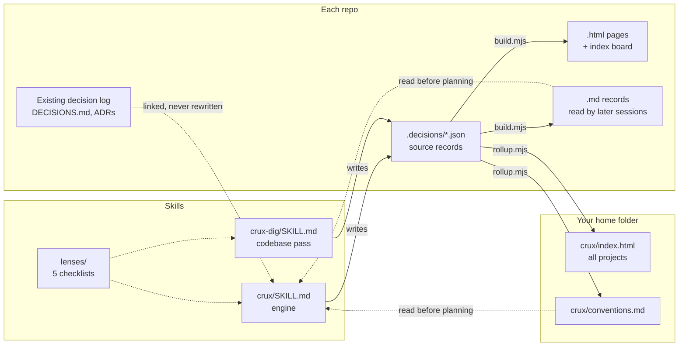

<p align="center"></p>

<h1 align="center">Crux</h1>

<p align="center"><b>Find the crux. See the options. Make the call.</b><br>
A lightweight decision layer for Claude Code.</p>

---

AI coding tools make dozens of decisions for you while you aren't looking: the data model, the solver method, where state lives, what the screen looks like. Crux stops at the handful that matter, shows you the options as pictures, waits for your pick, and keeps a record that every later session reads before planning.

Claude does the work around the decision. You make the call.

<!-- Replace with a screenshot from a real project when one is ready. -->
<p align="center"></p>

## How it works



- **Quick** for contained questions: two or three options in chat, a recommendation, you reply with a letter.
- **Full** for choices that are hard to reverse: three to five ranked decisions, each on its own page with a sketch per option, specific pros and cons, scored criteria, and a recommendation with a confidence level.
- **Deep**, added to either, researches each option in parallel (web and code), cites sources, and lists assumptions, risks and estimates with their basis. After you pick, it writes a **build brief** for the session that builds it.
- **Crux Dig** reads an existing codebase and drafts the decisions already baked into it. Each finding gets two separate reads: whether it was **deliberate**, and whether it is **holding up** or now **strained**. Strained findings are the candidates for your next real decisions.

<p align="center"></p>

## Commands

| You type | What happens |
| --- | --- |
| `/crux quick presets in the URL or a file` | Two or three options in chat, you reply with a letter |
| `/crux full plan the subsidence fork` | Three to five ranked decisions, one visual page each |
| `/crux deep plan the subsidence fork` | Full, plus research, sources, risks, estimates and a build brief |
| `/crux quick deep presets in the URL or a file` | One researched decision on a page |
| `/crux challenge 0003` | Claude argues against your pick; you keep it or reopen it |
| `/crux park 0007 until 2027-01-15` or `when the hosted backend starts` | Set a decision aside; it comes back on the date or when the trigger comes up |
| `/crux drop 0007` | Not doing this; kept as history so it is never proposed again |
| `/crux clear` | Lists unreviewed drafts, and deletes them only after you say yes |
| `/crux all` | Summary of what is waiting in every project, plus conflicts |
| `/crux-dig` or `/crux-dig src/solver` | Drafts decisions already in the code; re-running refreshes them in place |

Crux also steps in on its own, in quick mode, when Claude is about to make an architecture-level choice: a new dependency, a data model change, a solver or physics change, a change across several modules, or a research or product direction.

On any decision page you can also pick, park, drop, confirm, reject or edit, then press "Copy for Claude" and paste the line into your session.

## Decision lifecycle



Nothing that was decided, parked or rejected is ever deleted. It is superseded or kept as history, so the record of why things are the way they are stays intact. Only unreviewed drafts can be cleared.

## The board

Each repo gets `.decisions/index.html`, an offline page in the same style as the decision pages:

- **Where things stand**: a status bar and one tile per decision, coloured by state, each opening its page.
- **By area**: one row per lens, so you can see where strain clusters.
- **Board**: lanes for open items from the repo's own log, strained, needs your call, needs review, parked, decided and history. Empty lanes are hidden, and each lane shows its first five cards (three for decided and history) with "Show more" at the bottom, so the page stays short however many decisions pile up.
- **What builds on what**: a map of the links between decisions, foundations on the left.

<p align="center"></p>

## Across all your projects

Every time a decision changes, Crux refreshes one page covering every repo you have pulled down, plus a short conventions list that Claude reads before planning.

<p align="center"></p>

- **Projects collapse** to one summary row each, with a coloured bar of their states; click to see their tiles. Projects with open items or strained decisions start expanded, and your choices are remembered.
- **Next up** lists the five things most worth your attention across every project: open items first, then the oldest calls.
- **Waiting for a call** across all projects, oldest first, with anything over two weeks flagged and parked decisions that are due back.
- **Conflicts**: when two projects settle the same question differently (millimetres in one, metres in another), it shows at the top.
- **Conventions** each project has settled, so a new tool doesn't quietly contradict an old one.

## Architecture



| Part | What it does |
| --- | --- |
| `crux/SKILL.md` | The engine: modes, picking, parking, dropping, clearing, challenge and the cross-project summary |
| `crux-dig/SKILL.md` | The codebase pass: drafts findings with the deliberate and holding-up reads, links the repo's own decision log, refreshes in place on re-run |
| `crux/lenses/` | Short checklists Crux loads when relevant: architecture, data model, solver and physics, UI, research and product |
| `crux/template/` | Page, board and all-projects templates, plus the shared style. House UI rules are built in: no sideways scrolling, drawn icons only, no toggles |
| `crux/scripts/build.mjs` | Turns each repo's JSON records into pages, readable Markdown and the board, then refreshes the roll-up. No dependencies |
| `crux/scripts/rollup.mjs` | Scans your project folders, writes the all-projects page and conventions list, and flags conflicts, stale decisions and parked ones that are due |

The JSON records are the single source; everything else is regenerated from them. Claude writes the content, and the templates handle layout, so pages stay consistent and cost few tokens.

## What lands in each repo

```
.decisions/
  index.html                  the board
  0003-contact-model.json     the source Claude edits
  0003-contact-model.html     the visual page
  0003-contact-model.md       short readable record that later sessions read
```

Pages open in any browser, offline. Commit the folder so the records travel with the code.

## Install

See [INSTALL.md](INSTALL.md). Short version on Windows: clone this repo into `Documents\GitHub` with GitHub Desktop, then link the two skill folders into `C:\Users\<you>\.claude\skills\` so a pull updates Crux everywhere. If a session was already open, run `/reload-plugins`.

To see the pages before installing, open [example/demo-decisions/index.html](example/demo-decisions/index.html) after cloning. The example content is illustrative and its sources are placeholders.

## Design rules

- Nothing is built, edited or installed until you pick.
- Pages never scroll sideways and use drawn icons only.
- No toggles: everything is shown, ordered by what needs you first.
- Claims without a source are labelled as Claude's judgment.
- A repo's existing decision log stays the main record; Crux links to it and never rewrites it.
- Small on purpose: a few hundred lines of instructions, a few templates, and two scripts with no dependencies.

## License

[MIT](LICENSE)
