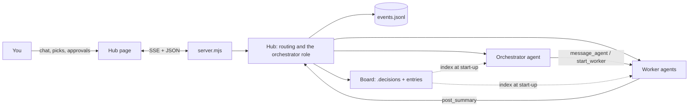

# Crux Hub

A small, messaging-style home for your Claude agents, built on Crux's memory board.

- **Needs you** collects every decision and permission request waiting on you. Pick with one click, take every recommendation at once, or reply in a few characters: `all`, `all but 4A`, `4A 7B`, or just `B` when one decision is open.
- **Orchestrator** is a role, not a session. Whoever holds it reads the board and the latest handoff, starts workers, answers their questions and sends them back. When its context gets full (60% by default) it writes a handoff to the board and retires; the next holder picks up from there.
- **Agents** work like normal Claude Code sessions in your project. When they finish a round they post a structured summary; decisions they raise show up as cards.
- **Memory board**: Crux decisions (`.decisions/`) plus requirements, conventions, memos and handoffs. Every new agent starts by reading its one-line index.

## Run it

```bash
cd hub
npm install
npm run login      # once: type /login, sign in with your Claude plan, then /exit
npm start -- C:/path/to/project-a C:/path/to/project-b
```

Then open http://localhost:4747. With no folders given, it uses `~/crux/hub.json` (`{ "projects": ["C:/path/a"] }`) or the current folder.

Options: `--port 4747`, `--retire-at 60` (orchestrator hands off at this % of context).

## Usage and billing

Agents run through the Claude Agent SDK on this machine's Claude Code login, so they draw from your Claude plan's limits, the same pool as your own Claude Code sessions. Several agents at once use those limits faster. An `ANTHROPIC_API_KEY` in your environment is ignored unless you set `CRUX_HUB_USE_API_KEY=1`.

## What it writes

| Where | What |
| --- | --- |
| `<project>/.crux/events.jsonl` | Append-only log: messages, summaries, picks, board entries, agent sessions. Threads and board entries are rebuilt from it. Commit it if you want the memory to travel with the repo. |
| `<project>/.decisions/*.json` | Your picks (status, choice, reason, date) on Crux records, then the Crux pages are rebuilt. Claude still writes everything else in a record. |

## How it fits together



Agents get these board tools: `board_index`, `board_read`, `post_entry`, `post_summary`; the orchestrator also gets `list_agents`, `message_agent` and `start_worker`. Tool calls that need permission (shell commands, for example) become Allow / Deny cards. Workers can edit files in the project; the orchestrator cannot.

The design choices behind all of this are recorded in [`../.decisions/`](../.decisions/index.html).
