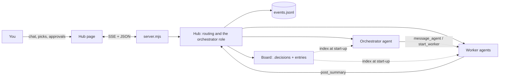

# Crux Hub

A small, messaging-style home for your Claude agents, built on Crux's memory board.

- **Needs you** collects every decision and permission request waiting on you. Pick with one click, take every recommendation at once, or reply in a few characters: `all`, `all but 4A`, `4A 7B`, or just `B` when one decision is open. Agents' questions wait there too, each with its own reply box (Yes and No buttons when the question is plainly yes or no). **Send answers** sends every filled box to that agent as one message, each question quoted above its answer. A question leaves Needs you when you answer or dismiss it, when you pick every decision it names ("decision 31", "D0031"), when someone replies in the agent's thread, or when the agent retires.
- **Orchestrator** is a role, not a session. Whoever holds it reads the board and the latest handoff, starts workers, answers their questions and sends them back. When its context gets full (60% by default) it writes a handoff to the board and retires; the next holder picks up from there.
- **Agents** work like normal Claude Code sessions in your project. When they finish a round they post a structured summary; decisions they raise show up as cards.
- **Memory board**: Crux decisions (`.decisions/`) plus requirements, conventions, memos and handoffs. Every new agent starts by reading its one-line index.

## Run it

```bash
cd hub
npm install
npm run login      # once: type /login, sign in with your Claude plan, then /exit
npm start -- C:/path/to/project-a C:/path/to/project-b
```

Then open http://localhost:4747. With no folders given, it uses `~/crux/hub.json` (`{ "projects": ["C:/path/a"] }`) or the current folder.

Options: `--port 4747`, `--retire-at 60` (orchestrator hands off at this % of context).

In the box at the bottom, Enter sends; Alt+Enter or Shift+Enter starts a new line. The box grows with the text, then scrolls inside. On a phone, the return key sends, as before.

## Restart the hub

- **From the hub:** click the three dots next to "Crux Hub" at the top of the thread list, then **Restart hub** and **Restart**. The hub stops and starts again in the background, with no window; the page says "Restarting..." and reconnects by itself. Agents that were working stop and pick up again on their next message, as after any restart.
- **When the hub is stuck or stopped:** double-click `hub\Restart Crux Hub.vbs`. It stops whatever is listening on port 4747, starts the hub again the way it was last started (same folder and projects), with no window, and opens it in your browser. If the hub does not come back, it says so.

To put it on your desktop: in File Explorer, open the `hub` folder of your Crux clone, right-click **Restart Crux Hub.vbs**, choose **Show more options**, then **Send to > Desktop (create shortcut)**. Rename the shortcut to "Restart Crux Hub" if you like. For the Crux icon: right-click the shortcut, **Properties > Change Icon... > Browse...**, and pick `hub\public\icons\crux.ico`. You can also drag the shortcut to the taskbar or Start to pin it.

A hub started this way writes what it prints to `hub-4747.log` in `~/.crux-hub/`, and each running hub notes how it was started in `launch-4747.json` there, so a restart starts it the same way. Your start-with-Windows setup is not changed: it keeps starting the hub at sign-in as before.

## On your phone (Tailscale)

The hub only listens on this PC (127.0.0.1). Your phone reaches it through Tailscale, a private network made of your own signed-in devices; nothing is opened to the internet or to your Wi-Fi (decision 18). The hub turns away requests addressed to any other name, and lets only its own page make changes.

**Before you start: check the PC's name.** Turning on HTTPS gets the PC a certificate, and every certificate's name is written to public certificate-transparency logs. The address will be `https://<pc-name>.<tailnet>.ts.net`, so the PC name should not say anything private (no client or employer names). Check it with `hostname` in a terminal. Rename it under Settings > System > About > Rename this PC if needed (it takes a restart).

1. **Install** Tailscale on the PC (https://tailscale.com/download/windows, or `winget install tailscale.tailscale`) and on the phone (App Store or Play Store).
2. **Sign in** on both with the same **personal** account (your personal Gmail, on the free Personal plan). Not a work email: a work domain starts a company trial instead.
3. **Turn on HTTPS:** in the admin console (https://login.tailscale.com/admin/dns), make sure MagicDNS is on, then click **Enable HTTPS** under HTTPS Certificates.
4. **Start the hub** as usual (`npm start`), then in a terminal on the PC:
   ```bash
   tailscale serve --bg 4747
   ```
   It prints the address, `https://<pc-name>.<tailnet>.ts.net`. `--bg` keeps it running across restarts; `tailscale serve status` shows it and `tailscale serve reset` stops it. Use `tailscale serve`, never `tailscale funnel` (funnel publishes to the whole internet).
5. **On the phone**, open that address. To put it on the home screen: in Safari tap Share, then **Add to Home Screen** (Android Chrome: menu, then **Install app**).
6. **Notifications:** open Crux from the home-screen icon and tap the bell at the top. Allow notifications; a test one arrives. On iPhone this works only from the home-screen icon (iOS 16.4 or later), not from a Safari tab.

Notifications arrive when a permission request waits for Allow, a decision is ready to pick, or an agent asks a question (questions wait a minute first, since the orchestrator often answers them itself). They say only what kind of card it is and which agent or decision number. Tapping one opens the hub at that card; the details load over Tailscale. Nothing is sent while you are using the hub on the PC on the same view.

The notification keys and the list of subscribed phones are kept in `~/.crux-hub/` (outside every repo). Tap the bell again to turn notifications off on a device. If the PC sleeps, the hub cannot be reached and no notifications go out.

## Agent types, models and effort

Each agent shows its model as a colour (Opus violet, Sonnet cyan, Haiku pink, Fable copper) on its icon, its thread header and its live-map station, and its effort as five pips (hollow when it uses the default). Click the chip in a thread's header to change model, effort or type. Model and effort switch at once on a running agent; a new type takes effect when the agent is next free, and it keeps its conversation.

Agent types are Claude Code's own agent files, so the same types work in plain Claude Code: `~/.claude/agents/*.md` for every project, `<project>/.claude/agents/*.md` for one project (that one wins on a name clash).

```markdown
---
name: reviewer
description: Reads a whole change before you click-test it, and reports bugs in plain words
model: sonnet          # opus, sonnet, haiku, fable, inherit, or a full model id
effort: medium         # the hub's addition: low, medium, high, xhigh, max
tools: Read, Grep, Glob, Bash   # limits which built-in tools it has; permission cards still apply
---
Standing instructions, added to the agent's start-up prompt.
```

The orchestrator sees the list and picks a type for each worker, or follows yours ("put a reviewer on it"). It can also change a running agent with `set_agent_settings`, which does the same as the chip ("put w1 on Sonnet"); each change is noted in that agent's thread and in the orchestrator's. Defaults per role can go in `~/crux/hub.json`: `{ "defaults": { "worker": { "model": "sonnet", "effort": "medium" }, "orchestrator": { "effort": "high" } } }`. Unset means Claude Code's own default.

## Usage and billing

Agents run through the Claude Agent SDK on this machine's Claude Code login, so they draw from your Claude plan's limits, the same pool as your own Claude Code sessions. Several agents at once use those limits faster. An `ANTHROPIC_API_KEY` in your environment is ignored unless you set `CRUX_HUB_USE_API_KEY=1`.

## What it writes

| Where | What |
| --- | --- |
| `<project>/.crux/events.jsonl` | Append-only log: messages, summaries, picks, board entries, agent sessions. Threads and board entries are rebuilt from it. Commit it if you want the memory to travel with the repo. |
| `<project>/.crux/attachments/` | Images pasted, dropped or attached in threads, and PNG/JPEG/GIF/WebP screenshots agents post (decision 23). Named by a hash of their bytes; message events carry only id, type and size. PNG, JPEG, GIF, WebP, up to 10 MB each, 6 per message. Served at `/att/<project>/<id>` to the hub's own page only. Agents receive them as image blocks; images over about 3.7 MB are pointed to by path instead. |
| `~/.crux-hub/` | Notification keys (`vapid.json`) and subscribed phones (`push-subscriptions.json`). Never in a repo. |
| `<project>/.decisions/*.json` | Your picks (status, choice, reason, date) on Crux records, then the Crux pages are rebuilt. Claude still writes everything else in a record. |

## How it fits together



Agents get these board tools: `board_index`, `board_read`, `post_entry`, `post_summary`; the orchestrator also gets `list_agents`, `list_agent_types`, `message_agent`, `start_worker` (with optional type, model and effort), `set_agent_settings` and `retire_worker`. Tool calls that need permission (shell commands, for example) become Allow / Deny cards. Workers can edit files in the project; the orchestrator cannot.

The design choices behind all of this are recorded in [`../.decisions/`](../.decisions/index.html).
