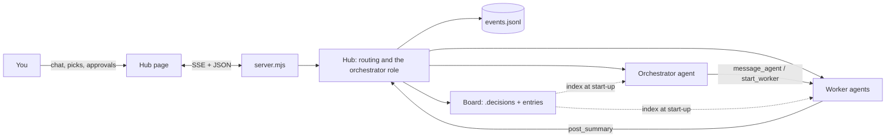

# Crux Hub

A small, messaging-style home for your Claude agents, built on Crux's memory board. It runs on your own PC; you use it in a browser tab, or on your phone through a private network.

- **Needs you** collects every decision and permission request waiting on you. Pick with one click, take every recommendation at once, or reply in a few characters: `all`, `all but 4A`, `4A 7B`, or just `B` when one decision is open. Agents' questions wait there too, each with its own reply box (Yes and No buttons when the question is plainly yes or no). **Send answers** sends every filled box to that agent as one message, each question quoted above its answer. A question leaves Needs you when you answer or dismiss it, when you pick every decision it names ("decision 31", "D0031"), when someone replies in the agent's thread, or when the agent retires.
- **Orchestrator** is a role, not a session. Whoever holds it reads the board and the latest handoff, starts workers, answers their questions and sends them back. When its context gets full (60% by default), when you press Hand off, or after an idle stretch (60 minutes above 25% context by default, decision 37; `idleHandoffMin` and `idleFloorPct` in hub settings, 0 minutes turns it off) it hands off and retires; the next holder picks up from there. Each round summary carries brief handoff notes, which the hub keeps as a rolling draft: when that draft is under an hour older than the holder's last turn, the hub publishes the handoff from it without waking the holder, and a holder that has rested an hour or more simply retires, so your next message starts a fresh one. The hub adds the facts: your approvals and instructions since the last handoff, each worker's last summary and last instruction, open PRs and worktrees, unanswered questions, waiting decisions and suggested board tidy-ups.
- **Agents** work like normal Claude Code sessions in your project. When they finish a round they post a structured summary; decisions they raise show up as cards.
- **Memory board**: Crux decisions (`.decisions/`) plus requirements, conventions, memos and handoffs. Every new agent starts by reading its one-line index.

## Run it

You need Node 20 or newer, git, and your own Anthropic API key (from the Anthropic Console). The GitHub CLI (`gh`, signed in) and Tailscale are optional. Keep the `hub` folder inside its Crux clone: it uses the page builder in `../crux/scripts/`.

```bash
git clone https://github.com/mshomper/crux.git
cd crux/hub
npm install
```

Then give the hub your key and start it. In PowerShell:

```powershell
$env:ANTHROPIC_API_KEY = "sk-ant-..."
$env:CRUX_HUB_USE_API_KEY = "1"
npm start -- C:/path/to/project-a C:/path/to/project-b
```

On Mac or Linux (untested):

```bash
export ANTHROPIC_API_KEY=sk-ant-...
export CRUX_HUB_USE_API_KEY=1
npm start -- ~/path/to/project-a
```

`CRUX_HUB_USE_API_KEY=1` is required: without it the hub removes `ANTHROPIC_API_KEY` from what its agents see, and they will not use the key. To keep the key across sessions, set both as user environment variables (Windows: Settings, search "environment variables"). The API-key start-up is read from the code (`lib/agent.mjs`) and has not yet been tested end to end on a fresh machine.

Then open http://localhost:4747. With no folders given, it uses `~/crux/hub.json` (`{ "projects": ["C:/path/a"] }`) or the current folder. Each project should be a git repo (see "Where your picks land").

Options: `--port 4747`, `--retire-at 60` (orchestrator hands off at this % of context), `--no-agents` (a test hub: messages are kept but no agent starts; also automatic when `CRUX_HUB_DATA` points inside the temp folder, and `CRUX_HUB_AGENTS=1` overrides both).

The **board** (top right) groups the memory into sections with counts: what waits for your call is open, everything else folds to one line until you open it, and the filter at the top finds words or ids (`D31`, `R5`) across all of it.

**Keyboard:** in Needs you, click or Tab to a card, then use the arrow keys (or J and K) to move between cards. A decision's option letter picks it, A allows and D denies a permission request, and Enter jumps into a question's reply box.

In the box at the bottom, Enter sends; Alt+Enter or Shift+Enter starts a new line. The box grows with the text, then scrolls inside. On a phone, the return key sends, as before.

### Environment settings

| Setting | What it does |
| --- | --- |
| `ANTHROPIC_API_KEY` | Your Anthropic API key. Used only when `CRUX_HUB_USE_API_KEY=1`. |
| `CRUX_HUB_USE_API_KEY` | Set to `1` so agents use the key. |
| `CRUX_HUB_PORT` | Port to listen on, if `--port` is not given (default 4747). |
| `CRUX_HOME` | Your private memory folder: profile, conventions, roll-up, and pictures agents post. Default `~/crux`. |
| `CRUX_HUB_DATA` | Where the hub keeps its own settings, notification keys and logs. Default `~/.crux-hub`. A folder inside the system temp folder makes a test hub (no agents start, nothing is pushed). |
| `CRUX_HUB_AGENTS` | Set to `1` to let a test hub start real agents. |
| `CRUX_HUB_HOSTS` | Extra machine names the hub answers to, comma-separated (for example a Tailscale name without `.ts.net`). |
| `CRUX_HUB_GH` | Full path to `gh`, if it is not on the PATH or in its usual Windows place. |
| `CRUX_HUB_VAPID_SUBJECT` | Contact address sent with phone notifications (a `mailto:` address). Default is a placeholder. |

### Windows shortcuts

- **`hub\Crux Hub.cmd`**: double-click to open the hub at http://localhost:4747, starting it first if it is not running. It reads the projects from `~/crux/hub.json` and leaves the hub running in a minimized window; close that window to stop it. It does not set your API key, so set the two variables as user environment variables first.
- **`hub\Restart Crux Hub.vbs`**: see below.

## Restart the hub

- **From the hub:** click the three dots next to "Crux Hub" at the top of the thread list, then **Restart hub** and **Restart**. The hub stops and starts again in the background, with no window; the page says "Restarting..." and reconnects by itself. Agents that were working stop and pick up again on their next message, as after any restart.
- **When the hub is stuck or stopped (Windows):** double-click `hub\Restart Crux Hub.vbs`. It stops whatever is listening on port 4747, starts the hub again the way it was last started (same folder and projects), with no window, and opens it in your browser. If the hub does not come back, it says so.

To put it on your desktop: in File Explorer, open the `hub` folder of your Crux clone, right-click **Restart Crux Hub.vbs**, choose **Show more options**, then **Send to > Desktop (create shortcut)**. Rename the shortcut to "Restart Crux Hub" if you like. For the Crux icon: right-click the shortcut, **Properties > Change Icon... > Browse...**, and pick `hub\public\icons\crux.ico`. You can also drag the shortcut to the taskbar or Start to pin it.

After any restart (the menu, the script, a crash or a Windows restart), agents that were in the middle of a turn, or had a message they never got to, wake on their own, in every project, a few seconds apart; resting agents stay asleep until their next message. A turn left unfinished for more than a day is not resumed. The Restart confirm and the script both say who will be resumed. An open hub page that reconnects to a hub with new page files reloads itself, keeping your view, and says "Updated to" the new version; the phone's home-screen app does the same.

A hub started this way writes what it prints to `hub-4747.log` in `~/.crux-hub/`, and each running hub notes how it was started in `launch-4747.json` there, so a restart starts it the same way.

## Who may do what (permissions)

Each project runs in one of two modes, switched with the Ask/Auto switch beside the project's name in the sidebar (decisions 21 and 34):

- **Auto:** work that stays inside the project, its worktrees or a temp folder runs without asking. Requests the hub cannot sort go to the orchestrator.
- **Ask** (the default): anything beyond reading goes to the orchestrator first.

The orchestrator answers within the permission rules on the project's board, and each answer is logged as one line in its thread for you to check. If it escalates, or has not answered within 2 minutes (`permissionTimeoutSec`), the request comes to you as an Allow / Deny card. **Hard stops always come to you**: merging, pushing to main, force-pushing, deleting branches, rewriting history, installing software, writing outside the project, network beyond GitHub, secrets, and anything touching the live hub. **Always** on a card saves the rule to the project's `.claude/settings.local.json`, where you can review or remove it. A repo can start in Auto with a committed `.crux-hub.json`: `{ "permissions": "auto" }`. Reading and searching never need a card. Workers can edit files in the project; the orchestrator cannot (it writes only decision records).

**claude.ai connectors** (mail, calendar, drive) are off in every project unless you turn them on with the project's switch, or with `{ "connectors": true }` in `.crux-hub.json`. Sending, sharing and deleting through them always comes to you.

## Where your picks land

When you pick in the hub, or the orchestrator drafts a decision, the record is written into a standing worktree at `<project>/.claude/worktrees/decisions`, on the branch `docs/decisions`, never into the project's main folder (decision 35). The hub rebuilds the Crux pages there, commits, and keeps one rolling pull request open, titled "Decision records (rolling)", for you to review and merge. The board reads both the main folder and this worktree, so a pick shows at once.

This needs the project to be a git repo with git installed. `gh`, signed in, is optional: without it (or offline) the commit stays local, a notice says so, and the next write tries again. A project that is not a git repo keeps its records in its own `.decisions/` folder. A test hub never pushes.

## Memory, lessons and handoffs

- **Profile and lessons.** Agents load a short profile from your private memory folder (`~/crux/profile/`, or `CRUX_HOME`): a core every agent reads, one pack per project, and a private section read only when a task needs it (the hub notes in the thread when an agent reads it). Agents record lessons as they go: project lessons go straight into that project's pack; lessons for the core wait in Needs you for your yes. Start from [`../profile-template/`](../profile-template/README.md) and keep the real folder out of any public repo.
- **Worker handoffs** follow the same rules as the orchestrator's: the hub writes the facts, the outgoing agent writes its judgement, and the new agent may ask the old one up to three questions. A worker's thread has **Retire** (job done) and **Hand off** (fresh agent, same job).
- **Sub-agents.** Workers may use Claude Code's own sub-agents for parts of a task. Their messages are kept out of the threads, and they do not appear on the live map.

## Several threads side by side

Pin a thread (the pin in its header, or on its row in the list when you point at it) to keep it open as a column; the next thread you open goes beside it, up to three columns (decision 39). The column you click or type in has the keyboard: a cyan line along its top and a lit message box. A red count in a column's header means a card waits for you there. When the columns do not fit (a narrow window, or the board open), the extra ones fold to a slim rail with their red counts; one click shows a folded one in place of the column you used least recently. With three pinned, opening a fourth thread takes the place of the keyboard column. Pins are remembered on that device, per project. On a phone, one thread at a time as before.

## Pictures in threads

Paste, drop or attach images in any thread; agents see them. Agents can post pictures (PNG, JPEG, GIF, WebP, SVG) or a small self-contained HTML page into their thread with `post_visual`; HTML pages run in a sandbox. Messages render Markdown. The hub also serves every project's Crux pages and an All projects view, so decision pages open inside it.

## On your phone (Tailscale)

The hub only listens on this PC (127.0.0.1). Your phone reaches it through Tailscale, a private network made of your own signed-in devices; nothing is opened to the internet or to your Wi-Fi (decision 18). The hub turns away requests addressed to any other name, and lets only its own page make changes. On a phone, the hub opens on Needs you when something waits; the thread list is behind Back.

**Before you start: check the PC's name.** Turning on HTTPS gets the PC a certificate, and every certificate's name is written to public certificate-transparency logs. The address will be `https://<pc-name>.<tailnet>.ts.net`, so the PC name should not say anything private (no client or employer names). Check it with `hostname` in a terminal. Rename it under Settings > System > About > Rename this PC if needed (it takes a restart).

1. **Install** Tailscale on the PC (https://tailscale.com/download) and on the phone (App Store or Play Store).
2. **Sign in** on both with the same account. A personal account is simplest; a work email domain may start a company trial instead.
3. **Turn on HTTPS:** in the admin console (https://login.tailscale.com/admin/dns), make sure MagicDNS is on, then click **Enable HTTPS** under HTTPS Certificates.
4. **Start the hub** as usual (`npm start`), then in a terminal on the PC:
   ```bash
   tailscale serve --bg 4747
   ```
   It prints the address, `https://<pc-name>.<tailnet>.ts.net`. `--bg` keeps it running across restarts; `tailscale serve status` shows it and `tailscale serve reset` stops it. Use `tailscale serve`, never `tailscale funnel` (funnel publishes to the whole internet).
5. **On the phone**, open that address. To put it on the home screen: in Safari tap Share, then **Add to Home Screen** (Android Chrome: menu, then **Install app**).
6. **Notifications:** open Crux from the home-screen icon, go Back to the thread list, and tap the bell beside the hub menu. Allow notifications; a test one arrives. On iPhone this works only from the home-screen icon (iOS 16.4 or later), not from a Safari tab.

Notifications arrive when a permission request waits for Allow, a decision is ready to pick, or an agent asks a question (questions wait a minute first, since the orchestrator often answers them itself). They say only what kind of card it is and which agent or decision number. Tapping one opens the hub at that card; the details load over Tailscale. Answering happens in the hub, not on the lock screen. Nothing is sent while you are using the hub on the PC on the same view.

On the phone, the boxes are sized so iPhone does not zoom in when you tap one, the message box stays just above the keyboard, and opening a thread does not pop the keyboard up; tap the box when you want to type. The longer typing hints (Alt+Enter, "all", "4A 7B") are left off; the quick-reply chips above the box do the picking.

**Phone check:** if something on the phone looks wrong (a zoom, a jump), open the hub menu (the three dots above the thread list) and tap **Phone check**, or add `?debug=phone` to the address in Safari. A small panel at the top shows live numbers: the visible area and its zoom, anything sticking out past the screen edge, the tapped box and its text size, and a count of jumps with what changed in each. Take a screenshot and send it. Tap **Hide phone check** in the menu (or use `?debug=off`) to turn it off; it is remembered on that phone until then. It never takes a tap.

Permission requests the orchestrator is handling never buzz the phone; a push goes out only when one becomes yours (a hard stop, the orchestrator sends it to you, or it has no answer after 2 minutes). When a card you were notified about is settled elsewhere, its notification is cleared as soon as the hub page opens on the phone, or with the next notification.

The notification keys and the list of subscribed phones are kept in `~/.crux-hub/` (outside every repo). Tap the bell again to turn notifications off on a device. If the PC sleeps, the hub cannot be reached and no notifications go out.

## Agent types, models and effort

Each agent shows its model as a colour (Opus violet, Sonnet cyan, Haiku pink, Fable copper) on its icon, its thread header and its live-map station, and its effort as five pips (hollow when it uses the default). Click the chip in a thread's header to change model, effort or type; the New agent dialog offers the same choices. Model and effort switch at once on a running agent; a new type takes effect when the agent is next free, and it keeps its conversation.

Each agent's icon is a robot for its model family (`public/robots.js`): Haiku a small egg with one antenna, Sonnet a rounded helmet with a crest, Opus a heavy angular helmet, Fable a drop-shaped lantern with one lens. The visor burns brighter with effort (with five pips on the brow at larger sizes), blinks when idle, pulses when working, goes dim when asleep, and turns red on the live map when that agent waits on you. The orchestrator wears a small crown. `/lab/robots-lab.html` shows every size, effort and state.

The whole app wears the live map's HUD frame (`public/hud.css`, switched on by `data-hud` on the page's `<html>`; remove the attribute for the plain app). Hairlines, small mono labels, chamfered glass plates and a faint grid frame the content, while messages and cards stay in the readable sans. Cards that wait for you carry red corner brackets; decision options have hexagon keys; a card opened from a notification locks on with a flash; a decision clicked on the board opens as a card inside the hub. A boot sequence of about a second and a half plays each time the hub opens. Under reduced motion the frame stays and nothing moves.

The live map's centre is the orchestrator role, drawn as a glass sphere of liquid light with nothing written on it. The liquid level is context used (a full sphere means the handoff is due; it turns gold over the last stretch and pulses gold when due), its colour is the model, and how hard it is stirred is effort and state. A red flare on the rim means something in the orchestrator's thread waits on you; a spark off the glass is a permission answer (green allowed, amber denied, red sent to you); loose motes around it mean Auto, the same motes held on two hoops mean Ask; streams of its particles run to workers that are working. Point at the sphere (or tap it) for the exact numbers. With reduced motion it is a still sphere at the right level. `/lab/core-lab.html` shows every state side by side (`?live` animates it).

Agent types are Claude Code's own agent files, so the same types work in plain Claude Code: `~/.claude/agents/*.md` for every project, `<project>/.claude/agents/*.md` for one project (that one wins on a name clash).

```markdown
---
name: reviewer
description: Reads a whole change before you click-test it, and reports bugs in plain words
model: sonnet          # opus, sonnet, haiku, fable, inherit, or a full model id
effort: medium         # the hub's addition: low, medium, high, xhigh, max
tools: Read, Grep, Glob, Bash   # limits which built-in tools it has; permission cards still apply
---
Standing instructions, added to the agent's start-up prompt.
```

The orchestrator sees the list and picks a type for each worker, or follows yours ("put a reviewer on it"). It can also change a running agent with `set_agent_settings`, which does the same as the chip ("put w1 on Sonnet"); each change is noted in that agent's thread and in the orchestrator's. Defaults per role can go in `~/crux/hub.json`: `{ "defaults": { "worker": { "model": "sonnet", "effort": "medium" }, "orchestrator": { "effort": "high" } } }`. Unset means Claude Code's own default.

## Usage and billing

Agents run through the Claude Agent SDK on this PC. With `CRUX_HUB_USE_API_KEY=1` they use your Anthropic API key, and Anthropic bills the tokens they use to that key. Several agents at once use more, faster. (Without the switch, agents fall back to whatever Claude Code sign-in is already on the PC; that is for your own personal use only, and the hub neither offers nor manages it.)

**Spend estimate.** The usage panel shows estimated spend today and since the hub started, per model and per agent. With an API key, open it by adding `?usagepanel` to the hub's address (http://localhost:4747/?usagepanel). Spend is estimated from list prices, not a bill; your Anthropic Console has the real figures.

**Plan meters (decision 36).** Only in the personal-use case above, the strip above the conversation shows meters (click them for the usage panel) for the plan's 5-hour, 7-day and Fable weekly windows, with percent used and time to reset; they turn amber at a warning or 80% and up, and red only when work is blocked. They come from the Agent SDK's usage call (marked experimental by the SDK), asked of one live agent every 5 minutes, plus the `rate_limit_event` agents stream. With an API key, plan limits do not apply, so the meters hide and the orchestrator thread gets one notice. With no agent running, the last reading stays, dimmed, with the time it was read.

## What it writes

| Where | What |
| --- | --- |
| `<project>/.crux/events.jsonl` | Append-only log: messages, summaries, picks, board entries, agent sessions. Threads and board entries are rebuilt from it. It holds everything said in every thread, so it can contain private material: keep it out of public repos (add `.crux/` to `.gitignore`, as this repo does). Commit it only to a private repo, if you want the memory to travel. |
| `<project>/.crux/events.jsonl` (usage) | `usage` events, one per agent result: what it added per model (input, output, cache tokens and estimated cost; the SDK reports running totals, so only the difference is kept) plus the totals, to resume from. `plan_usage` events: the plan windows, written only when they change by 2 points or more, or a status changes. |
| `<project>/.crux/attachments/` | Images pasted, dropped or attached in threads (decision 23). Named by a hash of their bytes; message events carry only id, type and size. PNG, JPEG, GIF, WebP, up to 10 MB each, 6 per message. Served at `/att/<project>/<id>` to the hub's own page only. Agents receive them as image blocks; images over about 3.7 MB are pointed to by path instead. |
| `<project>/.claude/worktrees/decisions/` | The `docs/decisions` worktree where picks and drafted records land (see "Where your picks land"). |
| `<project>/.claude/settings.local.json` | Rules you saved with **Always** on a permission card (Claude Code's own file). |
| `~/crux/` (or `CRUX_HOME`) | Your profile and its lessons, and `media/`, the pictures agents post with `post_visual`. Keep it private. |
| `~/.crux-hub/` (or `CRUX_HUB_DATA`) | Hub settings (`settings.json`, including each project's Auto/Ask and connector switches), notification keys (`vapid.json`), subscribed phones (`push-subscriptions.json`), and the restart files (`hub-<port>.log`, `launch-<port>.json`). Never in a repo. |

## How it fits together



Every agent gets these board tools: `board_index`, `board_read`, `post_entry`, `post_summary`, `propose_lesson` (record a lesson), `post_visual` (post a picture or page), `profile_read` (read the profile; the private section needs a reason) and `write_handoff`. An agent that took over from another also gets `ask_predecessor`. The orchestrator also gets `list_agents`, `list_agent_types`, `message_agent`, `start_worker` (with optional type, model and effort), `set_agent_settings`, `retire_worker` and `answer_permission`.

To stop a test hub you started on another port, run `node tools/stop-test-hub.mjs <port>`.

## Not yet

These are decided or planned but not built, so don't count on them:
- A desktop app wrapper (Tauri: own window, tray icon, installer, start at sign-in). Today the hub is a browser tab or a home-screen web app.
- A channel for ordinary terminal Claude Code sessions to join the board.
- Answer buttons on lock-screen notifications. A notification opens the card in the hub.
- Tested setup on Mac and Linux.

The design choices behind all of this are recorded in [`../.decisions/`](../.decisions/index.html).
